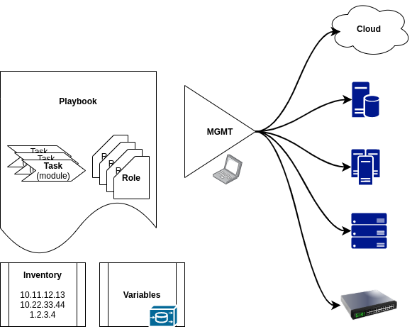
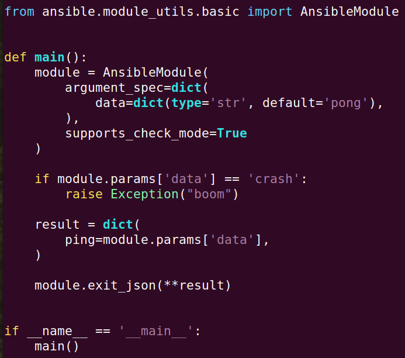
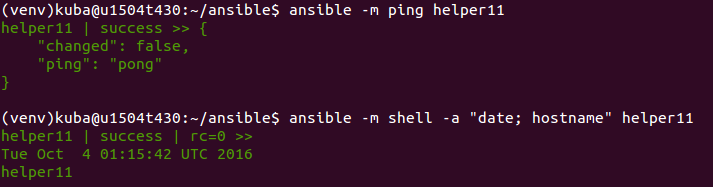
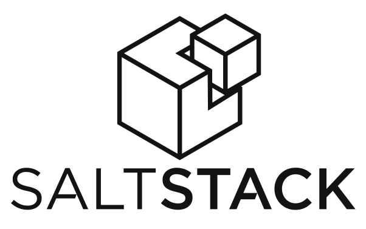
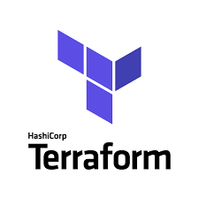
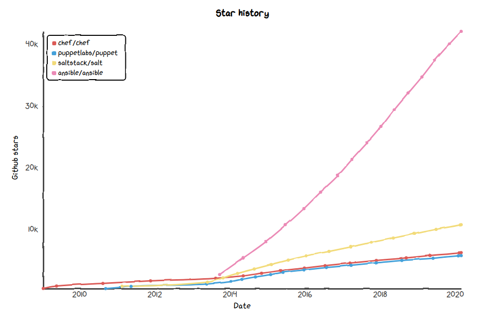
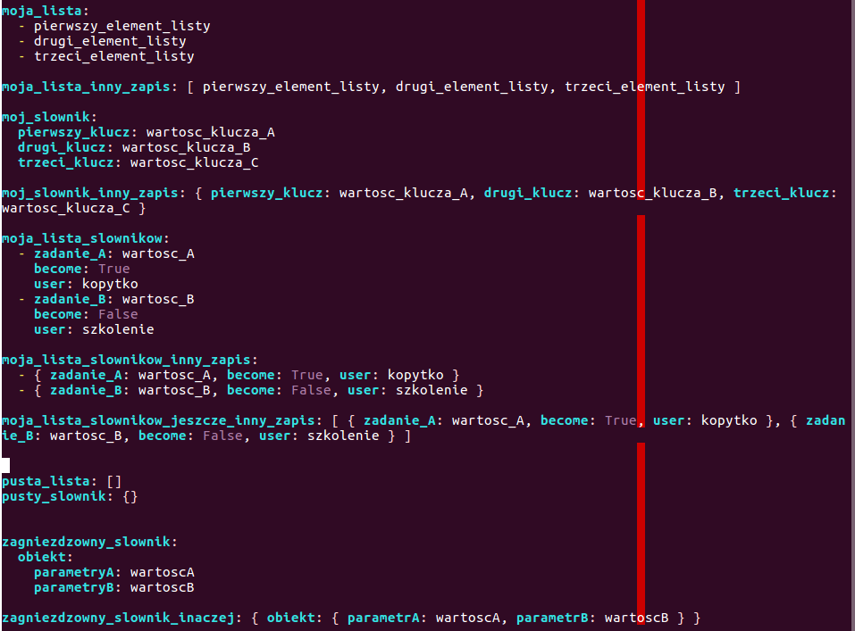
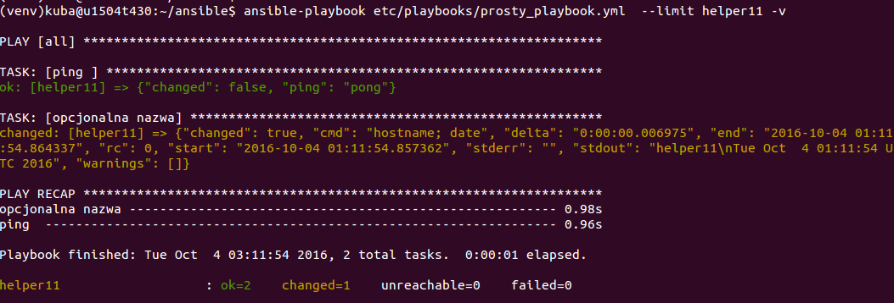

<!-- Wygenerowane z Dzien1_prezentacja.pptx przez szkolenie5dni/narzedzia/pptx_do_marp.py — nie edytuj ręcznie;
     zmieniaj pptx (albo build_dzienN_deck.py) i uruchom skrypt ponownie. -->

<!-- _class: tytul -->
# Ansible

Wszystko co musisz wiedzieć.

Jakub Muszyński

---

## Dzień 1 — plan

- 9:00 · Organizacja, logowanie na maszyny, instalacja Ansible
- 10:00 · Pokaz: Ansible w kilka minut → L1 środowisko
- 11:00 · Systemy orkiestracji, Ansible a Terraform → L2 polecenia ad-hoc
- 12:00 · YAML i Jinja2 → L3
- 12:50 · obiad
- 13:25 · Playbook → L4, część 1
- 14:25 · Inventory i zmienne → L5
- 15:25 · Shell kontra moduł → L4, część 2; podsumowanie

Przerwa 10 minut co 50 minut. Każdy blok: krótko teoria, od razu lab.

---

## Trzy słowa o ...

- DevOps @ BlueSoft.com
- 10-15 lat w branży, od sieci osiedlowej, przez małe software-house, korpo i startupy
- Ansible, on-prem, AWS, Azure, Kubernetes, CICD

Hobby:

- wspinaczka, ogrodnictwo:      [uInformatykaOgrodnika](https://www.facebook.com/uInformatykaOgrodnika/), [koty](https://www.facebook.com/Kocie-Fanaberie-445239988903993/), elektronika, Metro2033

---

## Trzy słowa o ...

- uczestnikach :)

---

<!-- _class: tytul -->
# Jaki jest cel warsztatów?

---

## Zanim zaczniemy

- 9:00–16:00; przerwa 10 minut co 50 minut; obiad 12:50–13:25
- Na kartce: adres Twojej maszyny, użytkownik i hasło

```
ssh kursant@<adres maszyny>
```

- Po zalogowaniu: powitanie z adresami hostów; laby w ~/dzien1

**Od razu: L1, krok 1 — venv i pip install ansible (1–2 minuty)**

Gotowe, gdy: ansible --version wypisuje wersję.

---

## Laboratoria - Dobre praktyki

omówienie środowiska laboratorium

Warsztat jest Wasz - ale... :)

screen/tmux

vim

github

virtualenv

```
grep -R   :)
```

---

## Jak pracujemy

- Każdy blok: 10–15 minut teorii → lab → 5 minut omówienia
- Każdy ma własne hosty: web01 (dev) i web02 (prod), Ubuntu 24.04
- Ansible instalujesz na swojej maszynie (control node); hosty potrzebują tylko SSH i Pythona
- Instrukcje: dzien1/lab/L1…L5; rozwiązania obok, w plikach \*\_odpowiedz
- Utknąłeś na 5 minut? Wołaj prowadzącego

---

<!-- _class: maly -->
## Środowisko labu
<!-- Zamiennik slajdu „Środowisko labu” (schemat z kształtów w pptx) dla wersji Marp; pptx_do_marp.py wstawia
     ten plik zamiast tekstu wyciągniętego ze slajdu. Zmieniasz schemat w build_dzien1_deck.py — popraw i ten plik. -->

```
 Twój laptop              Twoja maszyna (Ubuntu 24.04 w AWS) - tylko Twoja
+--------------+  ssh    +-------------------------------------------------+
| terminal,    | ------> | Ansible (venv z L1) - control node              |
| edytor       | kursant@| laby: ~/dzien1 ... ~/dzien5                     |
+------+-------+ <adres> |                                                 |
       :                 | Docker - hosty labu pod adresem 127.0.0.1       |
       : zapasowe        | +---------+ +---------+ +---------+ +---------+ |
       : wejście, gdy    | | web01   | | web02   | | web03   | | web04   | |
       : bezpośrednie    | |ssh  2221| |ssh  2222| |ssh  2223| |ssh  2224| |
       : SSH nie działa  | |www  8081| |www  8082| |www  8083| |www  8084| |
       :                 | +---------+ +---------+ +---------+ +---------+ |
       :                 +------------------------+------------------------+
       v                                          | -i inventory/szkolenie/prod.yml
 Wspólne dla grupy - sieć szkolenia w AWS         v
+------------------+   +-------+ +-------+ +-------+ +-------+
| mgmt (bastion)   |   | web01 | | web02 | | web03 | | web04 |  zapasowe hosty
| ssh szkolenieNN@ |   |chmura | |chmura | |chmura | |chmura |  i pokaz rozwiązań;
+------------------+   +-------+ +-------+ +-------+ +-------+  wspólne - uzgadniamy
```

- dzień 1–2: web01, web02 · dzień 3: + web03 · dzień 4: + web04
- Prowadzący: `srodowisko.yml` (maszyny w AWS), `przygotuj_kursantow.yml` (Docker, hosty, laby)
- Albo Twój laptop z Dockerem: `lab-env/setup.sh` — te same hosty i porty

---

## Ansible w kilka minut

**Akademia**Ansible.pl



---

## Wprowadzenie - pojęcia

**Moduł** -  każda wykonywalna “komenda” (program) w ekosystemie Ansible, mająca wejście/wyjście zgodne ze specyfikacją \[JSON/kilka podstawowych słowników\]

```
ansible -m ping localhost
```

---

## Wprowadzenie - moduł



---

## Moduł uruchamianie ad-hoc

Moduł ping

```
ansible -m ping localhost
```

Parametry wiersza poleceń

```
ansible --help
```

---

## Moduł uruchamianie ad-hoc

**Moduły** - wykonanie z CLI

```
$ansible -m nazwa_modulu [-a argumenty i parametry] grupa-hostow
$ ansible -m ping jakas-nazwa-hosta
$ ansible -m shell -a ‘hostname’ jakas-nazwa-hosta
```

---

## Wykonanie modułu ad-hoc (w CLI)



---

## Moduł ping

```
ansible -m ping localhost

ssh user@localhost ‘echo pong’
```

---

## Moduł shell

```
ansible -m shell -a ‘date; whoami; df -h /’ localhost

ssh user@localhost ‘date; whoami; df -h /’
```

---

## Moduł file

```
ansible -m file -a ‘path=/logi_aplikacji state=directory’ localhost

ssh user@localhost ‘mkdir /logi_aplikacji’
```

---

## Moduł copy

```
ansible -m copy -a ‘src=kofiguracja.conf dest=/etc/aplikacja/dane.conf’ localhost

scp kofiguracja.conf user@localhost:/etc/aplikacja/dane.conf
```

---

## Moduł apt

```
ansible -m apt -a ‘name=apache2’ localhost

ssh user@localhost apt-get install -y apache2
```

---

## Lab L1 — środowisko (część A)

**25 minut · L1\_srodowisko.md, część A**

- venv i pip install ansible (zrobione rano)
- inventory/hosts.yml: web01 i web02
```
ansible all -i inventory/hosts.yml -m ping
```

**Gotowe, gdy: 2 × SUCCESS**

---

**Dlaczego Ansible?**

**Systemy Orkiestracji**

---

<!-- _class: maly -->
## Systemy Orkiestracji

Systemy orkiestracji, znane również jako narzędzia do automatyzacji procesów IT, są to aplikacje lub oprogramowania, które pomagają w zarządzaniu i koordynacji skomplikowanych usług i procesów.

Główne cechy:

- **Automatyzacja procesów**: Automatyzacja codziennych zadań, takich jak instalacja i konfiguracja oprogramowania, zarządzanie usługami, tworzenie i zarządzanie środowiskami testowymi i produkcyjnymi, zarządzanie zasobami chmurowymi i wiele innych.
- **Orkiestracja zadań**: Zarządzają one wykonywaniem skomplikowanych procesów składających się z wielu zadań wykonywanych na wielu systemach. Na przykład, mogą one koordynować proces wdrażania aplikacji, który obejmuje takie zadania jak pobieranie kodu z repozytorium, budowanie i testowanie aplikacji, a następnie jej wdrażanie.
- **Zarządzanie konfiguracją**: Zapewniają one spójność konfiguracji pomiędzy różnymi środowiskami i systemami, co jest kluczowe dla zapewnienia stabilności i wydajności usług.
- **Zarządzanie infrastrukturą jako kodem (IaC)**: Systemy orkiestracji pozwalają na definicję i zarządzanie infrastrukturą IT za pomocą kodu

---

## Systemy Orkiestracji

- sposób połączenia - agentowe vs bezagentowe  czy pull vs push
- język aplikacji (Python,  Rubby, C++)
- język manifestów (YAML, JSON, specyficzny DSL, HCL)
- zapamiętywanie stanu środowiska

---

Idempotentność





<!--
DeklaratywnyBezagentowy
-->

---

## Dlaczego Ansible?

**Akademia**Ansible.pl



---

<!-- _class: maly -->
## Wprowadzenie

Ansible to otwarte narzędzie do automatyzacji IT, które może pomóc w konfiguracji systemów, wdrażaniu oprogramowania i innych zadaniach administracyjnych. Ansible wykorzystuje język YAML do definiowania zadań, które są wykonane na zdalnych urządzeniach czy platformach. Ansible jest "bezagentowe", co oznacza, że nie wymaga instalacji dodatkowego oprogramowania na zdalnych maszynach.

Główne cechy Ansible:

- Prostota i łatwość użycia: Ansible wykorzystuje język oparty na YAML, który jest łatwy do zrozumienia i czytania.
- Bezagentowe: Ansible nie wymaga instalacji specjalnego oprogramowania na maszynach, z którymi się łączy.
- Idempotentność: Ansible gwarantuje, że operacje będą wykonywane tylko raz, nawet jeśli są wywoływane wielokrotnie. Zapewnia spójność środowiska z jego opisem w formie kodu. Infrastructure as a Code

---

## Ansible a Terraform

**Terraform: postaw infrastrukturę**

- maszyny, sieć, load balancer, DNS w chmurze
- plik stanu: wie, co stworzył, i umie to usunąć
- zmiana często = zniszcz i stwórz od nowa

**Ansible: skonfiguruj systemy**

- pakiety, usługi, pliki, aplikacje
- bez pliku stanu: sprawdza host przy każdym uruchomieniu
- zmienia istniejący system

Najczęściej razem: Terraform tworzy maszyny, Ansible je konfiguruje (inventory dynamiczne — dzień 4).

---

## Jak działa Ansible

- W Ansible, zadania **najczęściej** są wykonane za pomocą modelu "push", co oznacza, że centralny węzeł sterujący (lub maszyna, na której jest uruchomiony Ansible) inicjuje połączenia do zdalnych węzłów, aby wykonać zadania.
- Ten model jest różny od modelu "pull", który jest stosowany przez niektóre inne narzędzia do zarządzania konfiguracją, gdzie to zdalne węzły inicjują połączenie do centralnego serwera, aby pobrać swoje instrukcje.
  - dlatego warto wspomnieć, że w przypadku ansible jest też możliwość użycia programu ansible-pull pobierające konfigurację z repozytorium kodu np. git, choć nie jest to najczęściej wybierane rozwiązanie

<!--
Przykłady w konsoli z dokumentacji
-->

---

<!-- _class: maly -->
## Jak działa Ansible - komunikacja

- W Ansible, zadania **najczęściej** są wykonane tak, centralny węzeł sterujący (lub maszyna, na której jest uruchomiony Ansible) inicjuje połączenia do zdalnych węzłów
- To połączenie najczęściej dotyczy maszyn z systemem operacyjnym Linux, i tak zwaną warstwą transportową jest protokół **ssh**.
- Dla systemów Windows do połączenia najczęściej wybierany jest protokół **winrm**
- Należy wyróżnić w osobnej kategorii moduły wykonywane **lokalnie**, bez inicjalizacji połączenia ‘poza’ węzeł sterujący.
- Wybrane moduły Ansible służą do wykonywania akcji nawiązujących komunikację poza węzeł na którym jest wykonywane zadanie, na przykład
  - pobranie informacji, pliku z internetu
  - konfiguracja usługi chmurowej - na przykład utworzenie maszyny wirtualnej
  - konfiguracja routera
  - konfiguracja bazy danych np. Postgresql, Oracle, SAP HANA
- są to połączenia za pomocą różnych protokołów, np. **HTTP REST API**  
  niekiedy protokołów własnych

<!--
Przykłady w konsoli z dokumentacji
-->

---

## Lab L2 — polecenia ad-hoc

**30 minut · L2\_adhoc.md**

- command, shell, raw — czym się różnią
- fakty: moduł setup; dokumentacja: ansible-doc
- file dwa razy: CHANGED → SUCCESS (idempotencja)
- cudzysłowy: gdzie rozwija się $USER
- copy, apt i --become

---

## Wprowadzenie

Pliki konfiguracji Ansible tworzymy przy użyciu 2 technologii  
  
Format konfiguracji - YAML

‘Szablonowanie’ i dynamiczne zmienne -  silnik Jinja2

**YAML**

**JINJA2**

---

## Wprowadzenie YAML

YAML (YAML Ain't Markup Language) to ludzko-czytelny język do serializacji danych. Jest powszechnie używany w konfiguracji oprogramowania, w plikach deploymentów, i w aplikacjach, które wymagają przenośnej i prostej do czytania reprezentacji struktur danych. YAML jest łatwy do zrozumienia i edytowania, a jednocześnie jest prosty do zinterpretowania dla maszyn.

Przykład pliku YAML:

```
employees:
  - id: 1
    name: John Doe
    position: Developer
  - id: 2
    name: Jane Doe
    position: Manager
```

---

## YAML

Proste wartości (skalarne):

```
number: 25
string: "Hello, world!"
boolean: true
null_value: null
empty_string: “”
```

<!--
YAML, czyli "YAML Ain't Markup Language", jest językiem służącym do reprezentowania struktur danych w łatwy do czytania sposób. YAML jest często używany do konfiguracji oprogramowania, serializacji danych i jako format wymiany danych pomiędzy językami programowania z funkcjami przetwarzania danych strukturalnych.

Oto kilka przykładów reprezentacji różnych struktur danych w YAML:

1. **Proste wartości (skalarne)**:
    ```yaml
    number: 25
    string: "Hello, world!"
    boolean: true
    null_value: null
    ```

2. **Listy** - reprezentowane przez myślniki (`-`):
    ```yaml
    fruits:
      - Apple
      - Banana
      - Orange
    ```

3. **Słowniki (mapy)** - para klucz-wartość oddzielona dwukropkiem (`:`):
    ```yaml
    person:
      name: John Doe
      age: 30
      city: New York
    ```

4. **Zagnieżdżone struktury** - można łączyć listy i słowniki do tworzenia zagnieżdżonych struktur:
    ```yaml
    employees:
      - name: John Doe
        job: Developer
        skills:
          - Python
          - Ansible
          - Kubernetes
      - name: Jane Doe
        job: Project Manager
        skills:
          - Scrum
          - Agile Methodology
          - JIRA
    ```

5. **Referencje (aliasy i kotwice)** - umożliwiają tworzenie odniesień do wcześniej zdefiniowanych wartości:
    ```yaml
    base: &base
      name: Everyone
      value: 100

    foo:
      <<: *base
      name: Foo

    bar:
      <<: *base
      name: Bar
    ```
    W tym przykładzie, `foo` i `bar` odnoszą się do słownika `base`. Operator `<<:` kopiuje wszystkie pola z referencji.

YAML jest łatwo czytelny dla ludzi i jest szeroko używany w wielu narzędziach i aplikacjach, w tym w Ansible. Jednak trzeba pamiętać o pewnych zasadach, jak na przykład konieczność stosowania odpowiednich wcięć do reprezentowania struktury danych.
-->

---

## YAML

Listy - reprezentowane przez myślniki (`-`)

```
fruits:
  - Apple
  - Banana
  - Orange

fruits: [ Apple, Banana, Orange ]

vegetables: []
```

<!--
YAML, czyli "YAML Ain't Markup Language", jest językiem służącym do reprezentowania struktur danych w łatwy do czytania sposób. YAML jest często używany do konfiguracji oprogramowania, serializacji danych i jako format wymiany danych pomiędzy językami programowania z funkcjami przetwarzania danych strukturalnych.

Oto kilka przykładów reprezentacji różnych struktur danych w YAML:

1. **Proste wartości (skalarne)**:
    ```yaml
    number: 25
    string: "Hello, world!"
    boolean: true
    null_value: null
    ```

2. **Listy** - reprezentowane przez myślniki (`-`):
    ```yaml
    fruits:
      - Apple
      - Banana
      - Orange
    ```

3. **Słowniki (mapy)** - para klucz-wartość oddzielona dwukropkiem (`:`):
    ```yaml
    person:
      name: John Doe
      age: 30
      city: New York
    ```

4. **Zagnieżdżone struktury** - można łączyć listy i słowniki do tworzenia zagnieżdżonych struktur:
    ```yaml
    employees:
      - name: John Doe
        job: Developer
        skills:
          - Python
          - Ansible
          - Kubernetes
      - name: Jane Doe
        job: Project Manager
        skills:
          - Scrum
          - Agile Methodology
          - JIRA
    ```

5. **Referencje (aliasy i kotwice)** - umożliwiają tworzenie odniesień do wcześniej zdefiniowanych wartości:
    ```yaml
    base: &base
      name: Everyone
      value: 100

    foo:
      <<: *base
      name: Foo

    bar:
      <<: *base
      name: Bar
    ```
    W tym przykładzie, `foo` i `bar` odnoszą się do słownika `base`. Operator `<<:` kopiuje wszystkie pola z referencji.

YAML jest łatwo czytelny dla ludzi i jest szeroko używany w wielu narzędziach i aplikacjach, w tym w Ansible. Jednak trzeba pamiętać o pewnych zasadach, jak na przykład konieczność stosowania odpowiednich wcięć do reprezentowania struktury danych.
-->

---

## YAML

Słowniki (mapy) - para klucz-wartość oddzielona dwukropkiem (`:`)

```
person:
  name: John Doe
  age: 30
  city: New York

person: { name: John Doe, age: 30, city: New York }

animal: {}
```

<!--
YAML, czyli "YAML Ain't Markup Language", jest językiem służącym do reprezentowania struktur danych w łatwy do czytania sposób. YAML jest często używany do konfiguracji oprogramowania, serializacji danych i jako format wymiany danych pomiędzy językami programowania z funkcjami przetwarzania danych strukturalnych.

Oto kilka przykładów reprezentacji różnych struktur danych w YAML:

1. **Proste wartości (skalarne)**:
    ```yaml
    number: 25
    string: "Hello, world!"
    boolean: true
    null_value: null
    ```

2. **Listy** - reprezentowane przez myślniki (`-`):
    ```yaml
    fruits:
      - Apple
      - Banana
      - Orange
    ```

3. **Słowniki (mapy)** - para klucz-wartość oddzielona dwukropkiem (`:`):
    ```yaml
    person:
      name: John Doe
      age: 30
      city: New York
    ```

4. **Zagnieżdżone struktury** - można łączyć listy i słowniki do tworzenia zagnieżdżonych struktur:
    ```yaml
    employees:
      - name: John Doe
        job: Developer
        skills:
          - Python
          - Ansible
          - Kubernetes
      - name: Jane Doe
        job: Project Manager
        skills:
          - Scrum
          - Agile Methodology
          - JIRA
    ```

5. **Referencje (aliasy i kotwice)** - umożliwiają tworzenie odniesień do wcześniej zdefiniowanych wartości:
    ```yaml
    base: &base
      name: Everyone
      value: 100

    foo:
      <<: *base
      name: Foo

    bar:
      <<: *base
      name: Bar
    ```
    W tym przykładzie, `foo` i `bar` odnoszą się do słownika `base`. Operator `<<:` kopiuje wszystkie pola z referencji.

YAML jest łatwo czytelny dla ludzi i jest szeroko używany w wielu narzędziach i aplikacjach, w tym w Ansible. Jednak trzeba pamiętać o pewnych zasadach, jak na przykład konieczność stosowania odpowiednich wcięć do reprezentowania struktury danych.
-->

---

## YAML

Zagnieżdżone struktury - można łączyć listy i słowniki do tworzenia zagnieżdżonych struktur:

```
employees:
  - name: John Doe
    job: Developer
    skills:
      - Python
      - Ansible
      - Kubernetes
  - name: Jane Doe
    job: Project Manager
    skills:
      - Scrum
      - Agile Methodology
      - JIRA
```

<!--
YAML, czyli "YAML Ain't Markup Language", jest językiem służącym do reprezentowania struktur danych w łatwy do czytania sposób. YAML jest często używany do konfiguracji oprogramowania, serializacji danych i jako format wymiany danych pomiędzy językami programowania z funkcjami przetwarzania danych strukturalnych.

Oto kilka przykładów reprezentacji różnych struktur danych w YAML:

1. **Proste wartości (skalarne)**:
    ```yaml
    number: 25
    string: "Hello, world!"
    boolean: true
    null_value: null
    ```

2. **Listy** - reprezentowane przez myślniki (`-`):
    ```yaml
    fruits:
      - Apple
      - Banana
      - Orange
    ```

3. **Słowniki (mapy)** - para klucz-wartość oddzielona dwukropkiem (`:`):
    ```yaml
    person:
      name: John Doe
      age: 30
      city: New York
    ```

4. **Zagnieżdżone struktury** - można łączyć listy i słowniki do tworzenia zagnieżdżonych struktur:
    ```yaml
    employees:
      - name: John Doe
        job: Developer
        skills:
          - Python
          - Ansible
          - Kubernetes
      - name: Jane Doe
        job: Project Manager
        skills:
          - Scrum
          - Agile Methodology
          - JIRA
    ```

5. **Referencje (aliasy i kotwice)** - umożliwiają tworzenie odniesień do wcześniej zdefiniowanych wartości:
    ```yaml
    base: &base
      name: Everyone
      value: 100

    foo:
      <<: *base
      name: Foo

    bar:
      <<: *base
      name: Bar
    ```
    W tym przykładzie, `foo` i `bar` odnoszą się do słownika `base`. Operator `<<:` kopiuje wszystkie pola z referencji.

YAML jest łatwo czytelny dla ludzi i jest szeroko używany w wielu narzędziach i aplikacjach, w tym w Ansible. Jednak trzeba pamiętać o pewnych zasadach, jak na przykład konieczność stosowania odpowiednich wcięć do reprezentowania struktury danych.
-->

---

## Format - YAML



---

## YAML

Dokumentacja Ansible

- [https://docs.ansible.com/ansible/latest/reference\_appendices/YAMLSyntax.html](https://docs.ansible.com/ansible/latest/reference_appendices/YAMLSyntax.html)

<!--
Przykłady w konsoli z dokumentacji
-->

---

<!-- _class: maly -->
## Jinja2

Jinja2 to silnik szablonów dla języka Python. Umożliwia dynamiczne generowanie dokumentów HTML, XML, lub innych formatów tekstowych.  
Jest często używany razem z narzędziami do automatyzacji, takimi jak Ansible, do generowania plików konfiguracyjnych na podstawie zmiennych, oraz do dynamicznego tworzenia wartości nowych zmiennych.  
  
Jinja2 umożliwia interpolację zmiennych w szablonach wyrażonych za pomocą podwójnych nawiasów klamrowych {{...}}.  
Pozwala również na wykonywanie pętli   dla zbioru elementów  
czy interpretacje warunków    
  
Posiada również zbiór funkcji (nazywanych filtrami Jinja filters)

---

## Jinja2 - przykładowy szablon

Przykład szablonu Jinja2:

W tym przykładzie, `{{ user_name }}` i `{{ current_date }}` to zmienne, które są zastępowane rzeczywistymi wartościami podczas renderowania szablonu.

```
<html>
<body>
    <h1>Welcome, {{ user_name }}!</h1>
    <p>Today's date is {{ current_date }}</p>
</body>
</html>
```

---

## Jinja2 w playbooku

```
- name: Jinja2 w playbooku
  hosts: localhost
  vars:
    aplikacja: sklep
    wersja: "1.4"
  tasks:
    - name: Wypisz wartości zmiennych
      ansible.builtin.debug:
        msg: "Wdrażam {{ aplikacja }} w wersji {{ wersja }}"
    - name: Katalog z nazwą ze zmiennych
      ansible.builtin.file:
        path: "/tmp/{{ aplikacja }}-{{ wersja }}"
        state: directory
```

- {{ zmienna }} działa w każdym argumencie modułu: w komunikacie, ścieżce, nazwie
- Wynik: "msg": "Wdrażam sklep w wersji 1.4"
- Wartość zaczyna się od {{ ? Cudzysłów — inaczej YAML zgłosi błąd

---

## Szablon: plik .j2

templates/aplikacja.conf.j2 — tekst pliku konfiguracyjnego ze wstawkami Jinja2

```
# Plik generuje Ansible — nie edytuj ręcznie
[aplikacja]
nazwa = {{ aplikacja }}
port = {{ aplikacja_port }}

backend = {{ serwer }}:{{ aplikacja_port }}

```

- {{ }} wstawia wartość zmiennej
-  to instrukcja: pętla, warunek — sama nie trafia do pliku
- Wszystko inne trafia do pliku bez zmian

---

## Playbook generuje konfigurację

```
- name: Konfiguracja z szablonu
  hosts: localhost
  vars:
    aplikacja: sklep
    aplikacja_port: 8080
    backendy: [web01, web02]
  tasks:
    - name: Wygeneruj plik konfiguracyjny
      ansible.builtin.template:
        src: aplikacja.conf.j2     # szuka w templates/
        dest: /tmp/aplikacja.conf
```

- Moduł template: szablon + zmienne → gotowy plik na hoście
- Ten sam szablon, inne zmienne (dev, prod) → inna konfiguracja

---

## Wynik: wygenerowany plik

```
$ ansible-playbook konfiguracja.yml     # changed=1
$ cat /tmp/aplikacja.conf
# Plik generuje Ansible — nie edytuj ręcznie
[aplikacja]
nazwa = sklep
port = 8080
backend = web01:8080
backend = web02:8080
```

- Drugie uruchomienie: changed=0 — plik już taki, jaki ma być
- -e aplikacja\_port=9090 --check --diff: widać, które linie by się zmieniły

Dalej: filtry — obróbka wartości w {{ }}.

---

## Szablony - Jinja2

```
filtry: join() default()  
---
{{ some_variable | to_json }}
{{ some_variable | to_yaml }}
{{ some_variable | default(5) }}

{{ [3, 4, 2] | max }}  - najwieksza wartość z listy

{{ list1 | difference(list2) }} 

{{ lista_portow_aplikacji | join(', ') }} 
        -> rezultat “1234, 3345, 2222, 7777”
```

---

<!-- _class: maly -->
## Jinja2

Dokumentacja

- Sablony Ansible [https://docs.ansible.com/ansible/latest/playbook\_guide/playbooks\_templating.html](https://docs.ansible.com/ansible/latest/playbook_guide/playbooks_templating.html)
- Jinja2 Szablony, if, for: [https://jinja.palletsprojects.com/en/latest/templates/](https://jinja.palletsprojects.com/en/latest/templates/)
- Filtry Jinja2: [https://jinja.palletsprojects.com/en/3.1.x/templates/#builtin-filters](https://jinja.palletsprojects.com/en/3.1.x/templates/#builtin-filters)
- Ansible i Filtry Jinja2 [https://docs.ansible.com/ansible/latest/playbook\_guide/playbooks\_filters.html#playbooks-filters](https://docs.ansible.com/ansible/latest/playbook_guide/playbooks_filters.html#playbooks-filters)

---

## YAML i Jinja2 podsumowanie

YAML jest używany do reprezentacji struktur danych   
	(w tym zmiennych, ale i opisu wykonywania zadań w playbookach, czy zbioru hostów w inventory)   
w łatwy do czytania i edytowania sposób.

Jinja2 jest używany do dynamicznego generowania dokumentów tekstowych na podstawie zmiennych i szablonów  
	oraz dynamicznego generowania zmiennych i struktur danych w playbookach.

---

## Lab L3 — YAML i Jinja2

**30 minut · L3\_yaml\_jinja.md · lokalnie, bez hostów**

- dane.yml: lista, słownik, lista słowników
- dostęp do danych: slownik.klucz, lista\[0\]
- filtry: default, join, length, map, selectattr
- bonus: pętla w szablonie raportu

---

## Wprowadzenie - Zadanie

**Task** - deklaracja użycia modułu (w playbook, roli)

Zadania są definiowane w playbookach lub rolach i są wykonywane sekwencyjnie. Każde zadanie może wywoływać moduł Ansible z określonymi argumentami.

```
tasks:
  - ansible.builtin.ping:

  - name: "zainstaluj nginx"
    ansible.builtin.apt:
      name: nginx
```

---

## Wprowadzenie - Zadanie

Możesz mieć wiele zadań w jednym playbooku. Wszystkie zadania są wykonane po kolei, jeden po drugim. Jeśli jedno zadanie nie powiedzie się, Ansible zatrzyma wykonanie playbooka, chyba że skonfigurujesz go inaczej.

---

## Wprowadzenie - Playbook

**Playbook**

(skrypt/manifest)

- plan wykonania zadań \[roli\]
- w formacie YAML
- może składać się z wielu elementów (np zmienne)

---

## Wprowadzenie - Playbook

Playbooki Ansible to pliki konfiguracyjne w formacie YAML, które definiują co Ansible ma zrobić. Są one zasadniczo zestawami zadań, procedurą którą Ansible wykonuje w określonej kolejności.

Playbooki są jednym z głównych sposobów interakcji z Ansible. Pozwalają opisać automatyzację w formacie czytelnym dla człowieka.

Playbook może składać się z jednego lub wielu "zagrań" (plays). Każde “zagranie” definiuje zestaw zadań do wykonania na grupie hostów, może być parametryzowane poprzez zmienne, czy korzystać z dodatkowych obiektów np pliki czy szablony konfiguracji.

---

## Playbook — anatomia

```
- name: Pierwszy playbook        # play: nazwa
  hosts: webservers              # gdzie: grupa z inventory
  become: false                  # bez sudo
  vars:                          # opcjonalnie: zmienne
    katalog_lab: /tmp/akademia
  tasks:                         # lista zadań, po kolei
    - name: Sprawdź połączenie
      ansible.builtin.ping:      # zadanie = moduł
    - name: Utwórz katalog
      ansible.builtin.file:      # moduł file
        path: "{{ katalog_lab }}" # argumenty modułu
        state: directory
```

Playbook to lista „zagrań” (plays). Każde mówi: na jakich hostach, z jakimi zmiennymi, które zadania.

---

## Wprowadzenie - Playbook

Gdy uruchamiasz playbook Ansible za pomocą polecenia `ansible-playbook`,

(najczęściej) Ansible łączy się z każdym z hostów zdefiniowanych w sekcji `hosts`, a następnie wykonuje na nich każde z zadań, w kolejności, w jakiej są one zdefiniowane w playbooku.

Playbooki Ansible są idempotentne, co oznacza, że możesz je uruchamiać wielokrotnie, a ostateczny stan systemu będzie taki sam. Ansible sprawdza stan każdego zadania i wykonuje je tylko wtedy, gdy jest to konieczne, aby osiągnąć żądany stan.

---

## Wprowadzenie: ansible-playbook

Playbook to ‘plan wykonania’ wielu modułów (tasks), w ściśle określony sposób.


---

## Wprowadzenie: ansible-playbook

Playbook to ‘plan wykonania’ wielu modułów w ściśle określony sposób.

Przykłady wykonania:

```
$ ansible-playbook scieżka/jakiś_playbook.yml [dodatkowe_opcje]

$ ansible-playbook scieżka/jakiś_playbook.yml -i jakieś_inventory --diff --check -v --become --ask-pass --tags paczki_systemowe -e zmiennaX=12345
```

---

## Wykonanie prostego playbooka




---

## Pełne nazwy modułów (FQCN)

```
ansible.builtin.file
kolekcja: ansible.builtin    moduł: file
```

- Od pierwszego playbooka piszemy pełne nazwy: od razu widać, skąd jest moduł
- Dokumentacja w konsoli: ansible-doc ansible.builtin.file
- W poleceniach ad-hoc wystarczy krótka nazwa: -m file
- Kolekcje, Galaxy i przypinanie wersji — dzień 3

---

## Zanim uruchomisz

```
ansible-playbook -i inventory/hosts.yml play.yml --syntax-check
ansible-playbook -i inventory/hosts.yml play.yml --check --diff
ansible-playbook -i inventory/hosts.yml play.yml
ansible-playbook -i inventory/hosts.yml play.yml   # 2. raz
```

- --syntax-check: tylko składnia, bez łączenia z hostami
- --check --diff: co by się zmieniło — niczego nie zmienia
- drugie uruchomienie z changed=0 = playbook idempotentny

---

## Lab L4 — pierwszy playbook

**35 minut · L4\_playbook.md, kroki 1–4**

- uzupełnij TODO w pierwszy\_playbook.yml
- --syntax-check → --check --diff → uruchomienie
- zmień treść wizytówki: ile zadań jest teraz changed?

**Gotowe, gdy: drugie uruchomienie daje changed=0**

---

## Wprowadzenie - Inventory

**Inventory** (inwentarz)

zbiór encji (hostów, obiektów itp. - ‘cokolwiek z adresem IP’)

może być statyczne i/lub dynamiczne

może przyjmować wiele postaci - plik, cały folder, skrypt

---

## Inventory

Przykład inventory w formie pojedynczego pliku w formacie INI

```
$ cat etc/inv/inventory_default 
[all:vars]
system_env = szkolenie
location = frankfurt

#przykład:
[localhost]
localhost ansible_connection=local ansible_python_interpreter=/usr/bin/python3

[mgmt]
172.16.4.14 ansible_ssh_private_key_file=~/.ssh/kuba_aws.pem
bastion.mojadomena.pl
zapasowy.mojadomena.pl jakas_zmienna=kopytko
```

---

## Inventory

Grupy w inventory

```
[backend-east]
backendE1
backendE2
[backend-west]
backendW1
backendW2
[backend:children]
backend-east
backend-west
```

---

## Inventory

Zbiór obiektów, zmiennych, parametrów - względem tego zbioru uruchamiamy nasze zadania (inventory może być dynamiczne!).

Inventory ‘rozumie’ drzewo katalogów zmiennych: host\_vars i group\_vars

```
inv/
  host_vars/
    bastion.mojadomena.pl.yml
  group_vars/
    mgmt.yml
```

---

## Inventory w YAML — nasze hosty

```
all:
  vars:
    ansible_user: ubuntu
    ansible_ssh_private_key_file: ~/.ssh/akademia_lab_key
  children:
    webservers:
      children:
        dev:
          hosts:
            web01: { ansible_host: 127.0.0.1, ansible_port: 2221 }
        prod:
          hosts:
            web02: { ansible_host: 127.0.0.1, ansible_port: 2222 }
```

Sprawdzenie: ansible-inventory -i inventory/hosts.yml --graph

---

## Zmienne

```
Ansible Variables
```

Zmienne w Ansible pozwalają na dynamiczne zarządzanie danymi w playbookach i szablonach.

Zmienne pozwalają na sterowanie parametrami wykonywania zadań w playbookach i rolach.

Zmienne umożliwiają adaptację playbooków do różnych środowisk i scenariuszy bez konieczności tworzenia wielu podobnych playbooków.

---

## Zmienne

Zmienne mogą przechowywać różne typy danych, takie jak tekst, liczby, listy, słowniki itp.

Można je zdefiniować na różnych poziomach, w wielu miejscach ekosystemu Ansible, np:

- Bezpośrednio w playbookach.
- W plikach inventory.
- W plikach zmiennych.
- W rolach, zarówno w katalogu `defaults` (o niskim priorytecie), jak i `vars` (o wysokim priorytecie).
- Jako argumenty linii poleceń.
- Jako zwracane fakty i zmienne zarejestrowane podczas wykonywania zadań.

---

## Zmienne w playbooku

```
- hosts: all
  vars:
    package_name: nginx
  tasks:
    - name: Ensure {{ package_name }} is installed
      ansible.builtin.apt:
        name: "{{ package_name }}"
        state: present
```

W tym playbooku zmienna package\_name jest zdefiniowana w sekcji vars i używana w zadaniu.

---

<!-- _class: maly -->
## Gdzie definiować Zmienne

Zmienne można nadpisywać.  
  
Kolejność priorytetu zmiennych w Ansible jest złożona i obejmuje wiele czynników, ale generalnie zmienne zdefiniowane “później” mają wyższy priorytet.

Dla przykładu możemy mieć zmienne ogólne, przypisane do wszystkich hostów z inventory, nazywam je ‘zmienne globalne’. Są przypisane do specjalnej grupy ‘all’.  
Dalej możemy mieć zmienne dla jakiejś specyficznej grupy hostów.  
Jeszcze szczegółowiej możemy opisać konkretny host.  
  
Wyższym priorytetem od zmiennych opisujących inventory, będa miały zmienne rejstrowane w trakcie wykonywania zadań. Możemy powiedzieć, że są one bardziej aktualne, a tym samym ważniejsze.

<!--
Przykłady zmienne T3L4 przeciazenie
-->

---

## Priorytety zmiennych — w labie L5

```
-e (extra vars)             ← zawsze wygrywa
vars w playbooku
host_vars/web01.yml
group_vars/prod.yml         ← grupa podrzędna
group_vars/webservers.yml   ← grupa nadrzędna
group_vars/all.yml          ← najsłabsze
```

- Co dostanie host: ansible-inventory --host web01
- Pełna lista poziomów: dokumentacja „Variable precedence”

---

## Zmienne

```
Wszystko jest słownikiem :)
```


---

## Zmienne

przykład wyświetlenia zmiennych (w trakcie wykonania Ansible)

```
ansible -m debug -a var=hostvars[inventory_hostname] all

ansible -m setup all
```

---

## Zmienne Dokumentacja Ansible

Link:

- Google “Ansible Variables” [https://www.google.com/search?q=ansible+variables](https://www.google.com/search?q=ansible+variables)
- [https://docs.ansible.com/ansible/latest/playbook\_guide/playbooks\_variables.html](https://docs.ansible.com/ansible/latest/playbook_guide/playbooks_variables.html)
- [https://docs.ansible.com/ansible/latest/reference\_appendices/special\_variables.html](https://docs.ansible.com/ansible/latest/reference_appendices/special_variables.html)

<!--
server {
    listen 80;
    server_name {{ server_name }};

    location / {
        proxy_pass http://{{ upstream_server }};
    }
}
-->

---

## Lab L5 — zmienne

**30 minut · L5\_zmienne.md**

- ciekawa\_zmienna: odkomentuj po kolei all → webservers → prod → host\_vars
- przed każdym uruchomieniem zapisz, czego się spodziewasz
- -e i vars w playbooku
- pułapka: cudzysłowy w -e

---

## Jak działa Ansible kolejność wykonania zadań

Plant wykonania zadań (**tasks)** w playbook to lista.  
Zgodnie z właściwościami listy, zadania wykonują się wedle kolejności (na liście),  
na każdym hoście!  
  
Ansible tworzy połączenie do zdalnego hosta (najczęściej za pomocą SSH) a następnie wykonuje zadanie na zdalnym hoście.   
W zależności od rodzaju zadania, może to obejmować wykonanie poleceń shell, przesyłanie plików, uruchamianie skryptów i tak dalej.

<!--
Przykłady w konsoli z dokumentacji
-->

---

## Jak działa Ansible kolejność wykonania zadań

Zagadnienia

- Kolejność: pre-tasks, roles, tasks, **post-tasks**, handlers
- Zadania wykonywane są w partiach po X hostów na raz, czekają na ‘najsłabsze ogniwo’
  - niekiedy i to można dynamicznie konfigurować (serial, threads)
- W przypadku błędu, wkonywanie kolejnych zadań **na wybranym** hoście jest przerywane, o ile nie skonfigurujemy inaczej
- Pomijanie zadań
- Wykonywanie zadań w pętli
- Bloki zadań lub include mogą być wykonywane z strategią inną niż domyślna

<!--
Przykłady w konsoli z dokumentacji
-->

---

## Shell kontra moduł

**shell / command**

- polecenie: „zrób to”
- zgłasza zmianę przy każdym uruchomieniu
- w --check pominięty
- sprawdzanie stanu piszesz sam

**moduł**

- stan: „ma być tak”
- zmienia tylko wtedy, gdy trzeba
- działa z --check i --diff
- sprawdzanie stanu jest w module

Nie ma modułu? command z creates albo removes; changed\_when — dzień 4.

---

## Lab L4 — część 2

**20 minut · L4\_playbook.md, kroki 5–7**

- pakiety tree i jq: become tylko dla jednego zadania
- shell\_kontra\_modul.yml: --check, potem dwa uruchomienia
- creates: ssh-keygen tylko raz

Krok 8 (własny playbook od zera) — zadanie domowe

---

## Podsumowanie dnia 1

- Ansible łączy się przez SSH i uruchamia moduły; na hostach nic nie instalujemy
- Inventory: hosty, grupy i ich zmienne
- Ad-hoc do jednorazowych operacji, playbook do powtarzalnych
- Moduł zamiast shell: idempotencja, --check, --diff
- Zmienne: od group\_vars/all do -e

**Jutro: pakiety, pliki, usługi, szablony → wdrożenie aplikacji jednym playbookiem**

---

## Zadanie domowe

- L3, krok 4: raport z szablonu (pętla w Jinja2)
- L4, krok 8: własny playbook od zera (/tmp/host\_is\_ready)
- Pytania z sekcji „Sprawdzenie” w L1–L5 — omówimy rano
- Chętni: poproś asystenta AI o playbook instalujący htop i sprawdź: moduł czy shell? idempotentny?

---

## Pytania?


