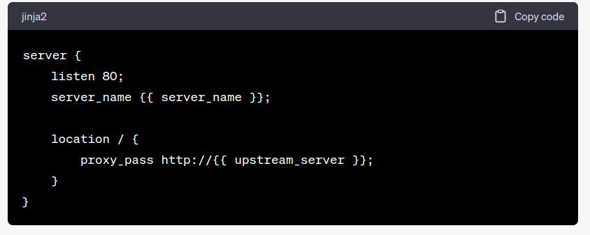

<!-- Wygenerowane z Dzien2_prezentacja.pptx przez szkolenie5dni/narzedzia/pptx_do_marp.py — nie edytuj ręcznie;
     zmieniaj pptx (albo build_dzienN_deck.py) i uruchom skrypt ponownie. -->

<!-- _class: tytul -->
# Ansible

Wszystko co musisz wiedzieć.

Jakub Muszyński

---

## Dzień 2 — plan

- 9:00 · Powtórka; pakiety i usługi → L6, część A
- 10:00 · Pliki konfiguracyjne i szablony → L6, część B
- 11:00 · Warunki, pętle, register, set\_fact → L7
- 12:00 · Projekt: wdrożenie aplikacji jednym playbookiem → L8, część 1
- 12:50 · obiad
- 13:25 · Konfiguracja z szablonów, uruchomienie aplikacji → L8, część 2
- 14:25 · Handlery, wait\_for, kolejność wykonania → L9
- 15:25 · Tagi; playbook z asystentem AI → L10; podsumowanie

Laby: dzien2/lab · inventory i ansible.cfg gotowe — piszesz bez -i

---

## Powtórka z dnia 1

- Co musi być na hoście, żeby Ansible nim zarządzał?
- command czy shell: którym przekierujesz wynik do pliku?
- Drugie uruchomienie playbooka dało changed=0. Co to znaczy?
- Ta sama zmienna w group\_vars/all.yml, group\_vars/prod.yml i -e. Co wygra na web02?
- Co sprawdzasz, zanim uruchomisz playbook na serwerach?

Odpowiedzi: L1–L5, sekcje „Sprawdzenie”.

---

## Cel dnia: od playbooka do aplikacji

```
L6  pakiety, usługi, pliki konfiguracyjne
L7  warunki, pętle, zmienne per środowisko
L8  aplikacja od dewelopera → jeden playbook
L9  restart tylko po zmianie, test po wdrożeniu
L10 tagi; playbook od asystenta AI pod kontrolą
```

Na koniec dnia: aplikacja działa na web01 (dev) i web02 (prod), a cały serwer stawia jedno polecenie.

Jutro ten playbook zamienimy w rolę i dołożymy bazę danych.

---

## Codzienna praca administratora — moduły

**System**

- ansible.builtin.apt — pakiety
- ansible.builtin.service — usługi
- ansible.builtin.user — konta
- ansible.builtin.reboot — restart (dzień 4)

**Pliki**

- file — katalogi, uprawnienia
- copy — plik bez zmiennych
- template — plik z szablonu Jinja2
- lineinfile, blockinfile — fragment pliku
- fetch — z hosta do Ciebie

Pełna lista z opisami: ansible-doc -l ansible.builtin

---

## Pakiety: ansible.builtin.apt

```
- name: Zainstaluj narzędzia
  ansible.builtin.apt:
    name: [htop, vim, curl]   # jedno wywołanie apt
    state: present
    update_cache: true
    cache_valid_time: 3600    # update raz na godzinę
```

- present: „ma być zainstalowany”; latest: „najnowszy” — wynik zależy od dnia uruchomienia
- absent z purge i autoremove: usuń razem z konfiguracją
- upgrade: safe — aktualizacja systemu

---

## Usługi: ansible.builtin.service

```
- name: Uruchom cron i włącz go przy starcie
  ansible.builtin.service:
    name: cron
    state: started      # działa teraz
    enabled: true       # startuje z systemem
```

- started / stopped — stan; restarted / reloaded — akcja (zawsze „changed”)
- service wybiera systemd albo init; ansible.builtin.systemd\_service — opcje tylko dla systemd

---

## Lab L6 — część A

**25 minut · L6\_administracja.md, część A**

- operacje\_pakiety.yml: uzupełnij TODO
- --syntax-check → --check --diff → uruchomienie
- sprawdź ad-hoc: htop, nano, cron

**Gotowe, gdy: drugie uruchomienie daje changed=0**

---

## Ansible Templates

Szablony Ansible to pliki, które umożliwiają generowanie docelowych skonfigurowanych plików dla różnych hostów na podstawie jednego szablonu. Szablony używają składni Jinja2, który pozwala na dynamiczne generowanie zawartości plików.  
  
Szablony są niezwykle przydatne, gdy musisz konfigurować wiele maszyn w podobny sposób, ale z pewnymi różnicami.   
Przykładowo, jeśli konfigurujesz serwer Apache na wielu maszynach, możesz użyć szablonu Ansible, aby automatycznie wstawi odpowiedni adres IP lub nazwę hosta do pliku konfiguracyjnego Apache.

<!--
Szablony Ansible to pliki, które umożliwiają generowanie skonfigurowanych plików dla różnych hostów na podstawie jednego szablonu. Szablony używają składni Jinja2, silnika szablonów dla języka Python, co pozwala na dynamiczne generowanie zawartości plików. 

Szablony są niezwykle przydatne, gdy musisz konfigurować wiele maszyn w podobny sposób, ale z pewnymi różnicami. Przykładowo, jeśli konfigurujesz serwer Apache na wielu maszynach, możesz użyć szablonu Ansible, aby automatycznie wstawić odpowiedni adres IP lub nazwę hosta do pliku konfiguracyjnego Apache.

W Ansible szablony tworzy się za pomocą modułu `template`. Oto przykładowy playbook, który używa szablonu:

```yaml
—-
- hosts: webservers
  tasks:
    - name: Configure Apache
      template:
        src: /path/to/your/template.j2
        dest: /etc/apache2/sites-available/000-default.conf
...
```

W tym playbooku, moduł `template` pobiera plik szablonu (`/path/to/your/template.j2`), przetwarza go, a następnie umieszcza wynikowy plik na zdalnych hostach (`/etc/apache2/sites-available/000-default.conf`).

W pliku szablonu `.j2` można korzystać z zmiennych Ansible, a także z wielu wbudowanych filtrów i funkcji Jinja2. Przykładowy plik szablonu może wyglądać tak:

```jinja2
<VirtualHost *:80>
    ServerName {{ ansible_fqdn }}
    DocumentRoot /var/www/html
</VirtualHost>
```

W tym szablonie, `{{ ansible_fqdn }}` to zmienna Ansible, która zostanie zastąpiona pełną nazwą domeny hosta.

Szablony Ansible są potężnym narzędziem, które pozwala na efektywne i elastyczne zarządzanie konfiguracją wielu maszyn.
-->

---

## Szablon Jinja2 — przykład

Poniżej znajduje się przykładowy szablon Jinja2 dla pliku konfiguracyjnego Nginx (`my_site.conf.j2`):

W tym szablonie, `{{ server_name }}` i `{{ upstream_server }}` to zmienne Ansible. Gdy Ansible wygeneruje plik z tego szablonu, zamieni te zmienne na odpowiednie wartości.



<!--
server {
    listen 80;
    server_name {{ server_name }};

    location / {
        proxy_pass http://{{ upstream_server }};
    }
}
-->

---

## Szablon w zadaniu

W tym zadaniu, moduł `template` używa szablonu `/etc/nginx/conf.d/my_site.conf.j2` i generuje plik `/etc/nginx/conf.d/my_site.conf` na zdalnym hoście. Zmienne `server_name` i `upstream_server` są zdefiniowane w sekcji `vars`.

Ta technika umożliwia dynamiczne generowanie plików konfiguracyjnych na podstawie zmiennych, co jest niezwykle użyteczne w różnorodnych środowiskach i konfiguracjach.

```
- name: Generate Nginx config file
  ansible.builtin.template:
    src: my_site.conf.j2
    dest: /etc/nginx/conf.d/my_site.conf
  vars:
    server_name: mysite.example.com
    upstream_server: 127.0.0.1:8080
```

<!--
server {
    listen 80;
    server_name {{ server_name }};

    location / {
        proxy_pass http://{{ upstream_server }};
    }
}

- name: Generate Nginx config file
  template:
    src: /etc/nginx/conf.d/my_site.conf.j2
    dest: /etc/nginx/conf.d/my_site.conf
  vars:
    server_name: mysite.example.com
    upstream_server: 127.0.0.1:8080
-->

---

## Ansible Templates

Dokumentacja Ansible

- Moduł Template [https://docs.ansible.com/ansible/latest/collections/ansible/builtin/template\_module.html](https://docs.ansible.com/ansible/latest/collections/ansible/builtin/template_module.html)
- Ciekawostka - delimitery Jinja w Ansible są konfigurowalne  
  [https://docs.ansible.com/ansible/latest/collections/ansible/builtin/template\_module.html#parameter-variable\_start\_string](https://docs.ansible.com/ansible/latest/collections/ansible/builtin/template_module.html#parameter-variable_start_string)

<!--
Przykłady w konsoli z dokumentacji
-->

---

## Plik w całości czy fragment?

**Cały plik**

- template: plik z szablonu, zmienne i fakty
- copy: plik bez zmiennych (src albo content)
- Ansible jest jedynym autorem pliku

**Fragment pliku**

- lineinfile: jedna linia (regexp + line)
- blockinfile: blok między znacznikami
- plik zmienia też ktoś inny (pakiet, człowiek)

Gdy możesz — szablon całego pliku: od razu widać, jak plik wygląda.

---

## lineinfile i blockinfile

```
- name: Włącz logowanie debug
  ansible.builtin.lineinfile:
    path: /etc/szkolenie/app.conf
    regexp: '^log_level='
    line: log_level=debug

- name: Dopisz sekcję monitoringu
  ansible.builtin.blockinfile:
    path: /etc/szkolenie/app.conf
    marker: "# {mark} ANSIBLE MANAGED — monitoring"
    block: |
      monitoring_enabled=true
```

copy z force: false tworzy plik tylko raz — potem zmieniają go lineinfile i blockinfile.

---

## Lab L6 — część B

**30 minut · L6\_administracja.md, część B**

- operacje\_pliki.yml: lineinfile, blockinfile, fetch
- MOTD z szablonu: fakty hosta w pliku
- ręczna zmiana na web01 → --check --diff → uruchomienie

---

## Warunki: when

```
- name: Oznacz serwer produkcyjny
  ansible.builtin.copy:
    content: "Serwer produkcyjny\n"
    dest: /opt/sklep/PRODUKCJA
    mode: '0644'
  when: "'prod' in group_names"

  when:                        # lista = wszystkie warunki
    - ansible_facts.os_family == "Debian"
    - app_debug | default(false) | bool
```

- W when nie piszemy {{ }} — to już wyrażenie Jinja2
- | bool: "false" z -e to napis — ansible-core 2.19+ zatrzyma się błędem, starsze wersje uznają go za prawdę

---

## Pętle: loop

```
- name: Utwórz użytkowników
  ansible.builtin.user:
    name: "{{ item.name }}"
    shell: "{{ item.shell }}"
  loop: "{{ uzytkownicy_aplikacji }}"
  when: item.aktywny | bool   # dla każdego elementu
  loop_control:
    label: "{{ item.name }}"  # krótszy log
```

- Moduł przyjmuje listę (apt name: \[...\])? Podaj listę zamiast loop — szybciej
- Stara składnia with\_items działa, w nowym kodzie piszemy loop

---

## register i set\_fact

```
- name: Sprawdź wersję Pythona
  ansible.builtin.command: python3 --version
  register: python_wersja   # stdout, rc, changed…
  changed_when: false       # tylko odczyt

- name: Wylicz własne zmienne hosta
  ansible.builtin.set_fact:
    python_na_hoscie: >-
      {{ python_wersja.stdout.split()[1] }}
```

- register w pętli: wyniki w .results, element pętli w item.item
- Zmienne z register i set\_fact żyją do końca uruchomienia, osobno dla każdego hosta

---

## Lab L7 — warunki i pętle

**30 minut · L7\_warunki\_petle.md**

- group\_vars/prod.yml: web02 staje się produkcją
- petle.yml: katalogi, użytkownicy, raport z register
- warunki.yml: fakty, group\_names, set\_fact
- jeśli zdążysz: jedna konfiguracja dla dev i prod

**Pytanie: co jest skipping na web01, a co na web02 — i dlaczego?**

---

## Kompletne wdrożenie aplikacji Budowa procesu CI/CD

- Historia z życia wzięta - zaprojektuj i wykonaj proces CI/CD
- Napisz playbook do wdrożenia pokazowej aplikacji
  - Przejdziemy przez proces krok po kroku
- Ciekawostka: Poznamy działanie check\_mode
  - Playbook do deinstalacji

<!--
Przykłady w konsoli z dokumentacji
-->

---

## Scenariusz: naszaaplikacja

- Deweloperzy dostarczają aplikację w Pythonie (Flask): kod, requirements.txt, przykładowe pliki konfiguracyjne, instrukcję
- Ma działać pod Apache z mod\_wsgi, w virtualenv, na dev i prod
- Nowe wersje będą często — ręczna instalacja to za każdym razem kilkanaście kroków

**Zadanie: instrukcja dewelopera → playbook wgraj\_aplikacje.yml**

Pokaz: aplikacja u dewelopera i 10 kroków instalacji z naszaaplikacja/README.md.

---

## Instrukcja dewelopera → playbook

```
apt install apache2 …        → apt
mkdir, chown www-data        → file
skopiuj kod                  → copy
python3 -m venv; pip install → pip
config.cfg, vhost, wsgi      → template
Listen w ports.conf          → lineinfile
a2ensite naszaaplikacja      → command + creates
systemctl restart apache2    → service; w L9 handler
```

Wszystkie moduły z kolekcji ansible.builtin. Parametry wdrożenia (katalogi, port, nazwa, wersja) w jednym miejscu: vars playbooka.

---

## Kod i biblioteki: copy i pip

```
- name: Wgraj kod aplikacji
  ansible.builtin.copy:
    src: naszaaplikacja/    # / na końcu: zawartość
    dest: "{{ aplikacja_katalog }}/"
    mode: '0644'

- name: Utwórz virtualenv i zainstaluj zależności
  ansible.builtin.pip:
    requirements: "{{ aplikacja_katalog }}/requirements.txt"
    virtualenv: "{{ aplikacja_katalog }}/venv"
    virtualenv_command: python3 -m venv
```

Bez ukośnika (src: naszaaplikacja) powstałby katalog naszaaplikacja/naszaaplikacja.

Moduł pip działa na hoście i potrzebuje tam python3-packaging (ansible-doc: Requirements).

---

## Lab L8 — część 1

**35 minut · L8\_wdrozenie.md, kroki 1–6**

- przeczytaj naszaaplikacja/README.md
- wgraj\_aplikacje.yml: zamieniaj debug „TODO” na moduły, krok po kroku
- pakiety → katalogi → kod → virtualenv

**Gotowe, gdy: venv/bin/pip list pokazuje Flask, drugie uruchomienie changed=0**

---

## Przykład od dewelopera → szablon

```
# naszaaplikacja.apache.conf.example
<VirtualHost *:5081>
    ErrorLog /var/www/szkolenie.pl/logs/error.log

# templates/naszaaplikacja.conf.j2
<VirtualHost *:{{ aplikacja_port }}>
    ErrorLog {{ aplikacja_log_dir }}/error.log
```

- cp przykład → templates/\*.j2, wartości zmieniasz na zmienne
- Kod: copy. Konfiguracja: template — bo zależy od środowiska
- srodowisko w config.cfg pochodzi z group\_vars (L7): dev na web01, prod na web02

---

## Nie ma modułu? creates i removes

```
- name: Włącz VirtualHost aplikacji
  ansible.builtin.command: a2ensite naszaaplikacja
  args:
    creates: /etc/apache2/sites-enabled/naszaaplikacja.conf

- name: Wyłącz domyślną stronę Apache
  ansible.builtin.command: a2dissite 000-default
  args:
    removes: /etc/apache2/sites-enabled/000-default.conf
```

- creates: pomiń, gdy plik JUŻ JEST; removes: pomiń, gdy pliku NIE MA
- Najpierw poszukaj modułu: ansible-doc -l community.general | grep apache

---

## Lab L8 — część 2

**35 minut · L8\_wdrozenie.md, kroki 7–11**

- trzy szablony z przykładów dewelopera
- port, a2ensite, restart Apache
```
curl http://localhost:8081/ i :8082/ — dev i prod
```

**Zanotuj: drugie uruchomienie — ile zmian i dlaczego?**

---

## Handlery: restart tylko po zmianie

```
tasks:
  - name: Wgraj konfigurację aplikacji
    ansible.builtin.template: {src: …, dest: …}
    notify: Restartuj Apache
handlers:
  - name: Restartuj Apache
    ansible.builtin.service:
      name: apache2
      state: restarted
```

- Handler wykonuje się, gdy zadanie z notify zgłosi zmianę (changed)
- Raz na host, choćby powiadomiło go pięć zadań; na końcu sekcji

---

## Kolejność wykonania w playu

```
pre_tasks   → handlery powiadomione w pre_tasks
roles       (dzień 3)
tasks       → handlery powiadomione w tasks
post_tasks  → handlery powiadomione w post_tasks
```

- post\_tasks: test po wdrożeniu widzi aplikację już po restarcie
- meta: flush\_handlers — wykonaj powiadomione handlery teraz
- Błąd na hoście = jego handlery się nie wykonają; --force-handlers albo force\_handlers: true

---

## Po restarcie: wait\_for i uri

```
handlers:
  - name: Restartuj Apache
    ansible.builtin.service:
      name: apache2
      state: restarted
    notify: Czekaj na aplikację   # handler → handler
  - name: Czekaj na aplikację
    ansible.builtin.wait_for: {port: 80, timeout: 30}
post_tasks:
  - name: Sprawdź, czy aplikacja odpowiada
    ansible.builtin.uri: {url: "http://localhost/health"}
```

- wait\_for: port przyjmuje połączenia; uri: aplikacja odpowiada kodem 200

---

## Lab L9 — handlery

**30 minut · L9\_handlery.md**

- restart jako handler, notify przy zadaniach
- zmiana wersji → handler tylko wtedy
- wait\_for, pre\_tasks, post\_tasks: zapisz kolejność
- jeśli zdążysz: pułapka — błąd po zmianie konfiguracji

---

## Ansible Tags

- Czym są Tagi
- Jak używać Tagów
  - Dziedziczenie tagów
  - Tags
  - Skip tags
  - Always i Never

<!--
Przykłady w konsoli z dokumentacji
-->

---

## Tagi w praktyce

```
    - name: Wgraj konfigurację aplikacji
      ansible.builtin.template: …
      tags: [konfiguracja]

ansible-playbook wgraj_aplikacje.yml --list-tags
ansible-playbook wgraj_aplikacje.yml --tags konfiguracja
ansible-playbook wgraj_aplikacje.yml --skip-tags pakiety
ansible-playbook wgraj_aplikacje.yml --tags diagnostyka
```

- always: zawsze, także przy --tags; never: tylko na żądanie
- Powiadomione handlery wykonują się niezależnie od tagów

---

## Kiedy tagów nie używać

- Do sterowania kolejnością wdrożenia — od tego są osobne playbooki i role
- Gdy zadania z tagiem zależą od zadań bez niego: --tags konfiguracja na nowym hoście padnie
- Gdy tagów jest kilkadziesiąt i nikt nie wie, co uruchamia który

**Na start: 2–4 tagi według części playbooka i never dla diagnostyki**

---

## Co zostaje inżynierowi, gdy kod pisze AI?

„AI przejęła tę część inżynierii oprogramowania, która polega na pisaniu kodu. Ale inżynieria to znacznie więcej: zrozumienie klientów, skalowalność, utrzymanie, obserwowalność. Najważniejsze są decyzje techniczne. Kiedyś większość czasu spędzaliśmy na pisaniu kodu, bo była to najbardziej żmudna, ręczna część pracy. Dlatego wydawało się, że inżynieria to tylko kodowanie. Nigdy tak nie było”

**Darko Mesaroš, Distinguished Developer Advocate, AWS**

ITwiz, 20.11.2026: itwiz.pl/co-zostaje-programiscie-gdy-kod-pisze-juz-ai/

---

## Playbook od asystenta AI

- Opisz zadanie, hosty i ścieżki; nie wklejaj haseł, kluczy ani adresów firmowych serwerów
- Pełne nazwy modułów? Moduł zamiast shell, gdy moduł istnieje?
- --syntax-check, potem --check --diff na hostach testowych
- Drugie uruchomienie: changed=0
- Rozumiesz każdą linię? Jeśli nie — zapytaj albo przeczytaj ansible-doc

**AI pisze szybko szkic; za to, co trafi na serwery, odpowiadasz Ty**

---

## Lab L10 — tagi i AI

**20 minut · L10\_tagi.md**

- tagi pakiety, kod, konfiguracja; --tags, --skip-tags, never
- usun\_aplikacje.yml z asystentem AI — sprawdź przed uruchomieniem
- --check na hoście bez aplikacji: co pada i dlaczego?

**Na koniec: aplikacja od zera jednym poleceniem**

---

## Podsumowanie dnia 2

- Moduły do pakietów, usług i plików; szablon, gdy plik zależy od hosta
- when, loop, register, set\_fact: jeden playbook dla dev i prod
- Instrukcja dewelopera zamieniona w playbook: wdrożenie jednym poleceniem
- Handlery: restart tylko po zmianie; test po wdrożeniu w post\_tasks
- --check to symulacja, nie gwarancja

**Jutro: playbook → rola, Galaxy i kolekcje, baza danych, load balancer**

---

## Zadanie domowe

- L7, krok 4, jeśli nie zdążyłeś: konfiguracja per środowisko
- L8, dodatkowe: trzy zadania template zastąp jednym z loop
- L9, krok 5: pułapka handlerów i --force-handlers
- Pytania z sekcji „Sprawdzenie” w L6–L10 — omówimy rano

---

## Pytania?


