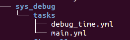
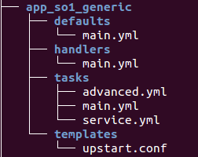
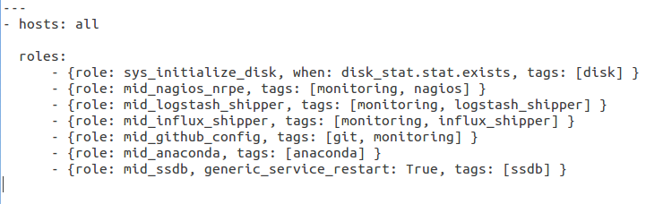

<!-- Wygenerowane z Dzien3_prezentacja.pptx przez szkolenie5dni/narzedzia/pptx_do_marp.py — nie edytuj ręcznie;
     zmieniaj pptx (albo build_dzienN_deck.py) i uruchom skrypt ponownie. -->

<!-- _class: tytul -->
# Ansible

Wszystko co musisz wiedzieć.

Jakub Muszyński

---

## Dzień 3 — plan

- 9:00 · Powtórka; role → L11, część A: playbook z dnia 2 zamieniamy w rolę
- 10:00 · Rola w site.yml; defaults a vars; import a include → L11, część B
- 11:00 · Ansible Galaxy i kolekcje; przypięte wersje → L12
- 12:00 · Projekt wielowarstwowy: baza danych z roli z Galaxy → L13, część 1
- 12:50 · obiad
- 13:25 · Spięcie warstw: hostvars i groups → L13, część 2
- 14:25 · Load balancer i skalowanie na trzeci host → L14
- 15:25 · Diagnoza warstwami; podsumowanie części podstawowej

Laby: dzien3/lab · od dziś trzy hosty: web01, web02, web03

---

## Powtórka z dnia 2

- Kiedy template, a kiedy lineinfile?
- Co zawiera zmienna z register po pętli? Gdzie jest element pętli?
- Ile razy wykona się handler powiadomiony przez trzy zadania?
- W jakiej kolejności: pre\_tasks, tasks, handlery, post\_tasks?
- Dlaczego --check na czystym hoście może skończyć się błędem?

Odpowiedzi: L6–L10, sekcje „Sprawdzenie”.

---

## Cel dnia: aplikacja w trzech warstwach

```
klient
  │  http://localhost:8081
  ▼
web01  load balancer (nginx)        loadbalancers
  │
  ├──► web02  aplikacja (Apache)     appservers
  └──► web03  aplikacja (od L14)     appservers
         │
         ▼
web01  baza danych (MySQL)          databases
```

Jedno polecenie stawia całość: ansible-playbook site.yml. Grupy w inventory to warstwy.

---

<!-- _class: maly -->
## Środowisko labu
<!-- Zamiennik slajdu „Środowisko labu” (schemat z kształtów w pptx) dla wersji Marp; pptx_do_marp.py wstawia
     ten plik zamiast tekstu wyciągniętego ze slajdu. Zmieniasz schemat w build_dzien1_deck.py — popraw i ten plik. -->

```
 Twój laptop              Twoja maszyna (Ubuntu 24.04 w AWS) - tylko Twoja
+--------------+  ssh    +-------------------------------------------------+
| terminal,    | ------> | Ansible (venv z L1) - control node              |
| edytor       | kursant@| laby: ~/dzien1 ... ~/dzien5                     |
+------+-------+ <adres> |                                                 |
       :                 | Docker - hosty labu pod adresem 127.0.0.1       |
       : zapasowe        | +---------+ +---------+ +---------+ +---------+ |
       : wejście, gdy    | | web01   | | web02   | | web03   | | web04   | |
       : bezpośrednie    | |ssh  2221| |ssh  2222| |ssh  2223| |ssh  2224| |
       : SSH nie działa  | |www  8081| |www  8082| |www  8083| |www  8084| |
       :                 | +---------+ +---------+ +---------+ +---------+ |
       :                 +------------------------+------------------------+
       v                                          | -i inventory/szkolenie/prod.yml
 Wspólne dla grupy - sieć szkolenia w AWS         v
+------------------+   +-------+ +-------+ +-------+ +-------+
| mgmt (bastion)   |   | web01 | | web02 | | web03 | | web04 |  zapasowe hosty
| ssh szkolenieNN@ |   |chmura | |chmura | |chmura | |chmura |  i pokaz rozwiązań;
+------------------+   +-------+ +-------+ +-------+ +-------+  wspólne - uzgadniamy
```

- dzień 1–2: web01, web02 · dzień 3: + web03 · dzień 4: + web04
- Prowadzący: `srodowisko.yml` (maszyny w AWS), `przygotuj_kursantow.yml` (Docker, hosty, laby)
- Albo Twój laptop z Dockerem: `lab-env/setup.sh` — te same hosty i porty

---

<!-- _class: tytul -->
# Playbooks - Role

---

## Role

**Playbook:**

- Zbiór tasków (zmiennych itp).

**Role:**

- Grupa tasków (zmiennych, handlerów, meta-danych) - zawarta w spójnej “paczce” - do łatwego wielokrotnego użycia (trochę jak paczka \*.deb przed zbudowaniem).

---

## Role - przykładowy układ katalogów

Nazwa roli to nazwa katalogu




---

## Role

Rola to w pewnym sensie elementy z playbooka wyniesione do osobnego katalogu celem nadania rozwiązaniu spójnej struktury.   
Katalog roli jest posortowany na podkatalogi:  
defaults, templates, files, tasks, vars, handlers, meta

Ułatwia to utrzymanie i rozwój kodu.

Każdy podkatalog ma plik main.yml, a z tego pliku includujemy kolejne potrzebne zasoby z podfolderu.

---

## Playbook → rola

```
ansible-galaxy role init roles/aplikacja

roles/aplikacja/
├── tasks/main.yml      ← sekcja tasks:
├── handlers/main.yml   ← sekcja handlers:
├── templates/          ← szablony .j2
├── files/              ← pliki bez zmian (kod)
├── defaults/main.yml   ← parametry (sekcja vars:)
├── vars/main.yml       ← stałe roli
└── meta/main.yml       ← opis, zależności
```

W roli: src: config.cfg.j2 zamiast src: templates/config.cfg.j2 — rola szuka we własnych katalogach.

---

## Lab L11 — część A

**25 minut · L11\_role.md, kroki 1–4**

- wgraj\_aplikacje.yml na appservers: stan wzorcowy na web02
```
ansible-galaxy role init roles/aplikacja
```

- przenieś zadania, handlery, szablony, kod i zmienne
- zmienne roli z prefiksem aplikacja\_

---

## Rola w site.yml — i test refaktoryzacji

```
- name: Warstwa aplikacji
  hosts: appservers
  become: true
  pre_tasks:
    - name: Pokaż, co wdrażamy …
  roles:
    - aplikacja
  post_tasks:
    - name: Sprawdź, czy aplikacja odpowiada …
```

**Ten sam stan co po playbooku z dnia 2 = changed=0**

Każda zmiana to różnica między rolą a playbookiem — sprawdź ją przez --check --diff.

---

## defaults, group\_vars, vars — kto wygrywa

```
-e (extra vars)                ← zawsze wygrywa
roles/aplikacja/vars/main.yml  ← stałe roli
vars w playbooku
group_vars/appservers.yml
group_vars/all.yml
roles/aplikacja/defaults/      ← najsłabsze
```

- defaults/: parametry — łatwo nadpisać w inventory
- vars/: to, czego nie wolno nadpisać (lista pakietów); pułapka: wygrywa z group\_vars

---

## Role - definiowanie w playbooku

	`- { role: mid_redis_server, when: redis_cache is defined and redis_cache == True, tags: ['redis'], become: True}`

Rola może być “otagowana”, przyjmować zmienne, mieć logikę.



---

## import\_role kontra include\_role

**import\_role (i roles:)**

- wczytana przed uruchomieniem
- --list-tasks i --list-tags widzą zadania roli
- when dopisany do każdego zadania
- bez pętli

**include\_role**

- wczytana w trakcie, gdy dojdzie do zadania
- listy widzą tylko jedno zadanie
- when sprawdzany raz
- loop: rola kilka razy z różnymi parametrami

To samo dotyczy import\_tasks i include\_tasks. Na start: roles: albo import\_role.

---

## Lab L11 — część B

**35 minut · L11\_role.md, kroki 5–9**

- site.yml: pre\_tasks, roles, post\_tasks

**Dowód: changed=0 na web02**

- defaults kontra group\_vars kontra vars: pułapka
- import\_include.yml: --list-tasks, --list-tags

---

## Skąd pełne nazwy modułów

```
community.mysql.mysql_db
    │       │      └─ moduł
    │       └─ kolekcja
    └─ przestrzeń nazw
```

- ansible-core: silnik i kolekcja ansible.builtin
- pakiet ansible (pip install ansible): ansible-core + ok. 90 kolekcji
- Kolekcja: moduły, wtyczki, role i playbooki w jednej paczce z wersją

---

## Kolekcje

Kolekcje to nowy sposób dystrybucji rozwiązań Ansible w formie paczki, która może składać sie z  
  
playbook  
role  
module  
plugins

---

## Trochę historii — po co przypinać wersje

```
2013  Ansible 1.0 — moduły w jednym repozytorium
2019  Ansible 2.9 — ostatnie wydanie „wszystko w jednym”
2020  Ansible 2.10 — podział: ansible-base + kolekcje
2021  ansible-core 2.11, pakiet ansible 4
2026  ansible-core 2.22, pakiet ansible 15
```

- Moduły zmieniają kolekcje: community.mysql.\* → ansible.mysql.\*
- Stara składnia znika: include: usunięte w ansible-core 2.16 (stare laby szkolenia przestały działać)
- Nowe ansible-core dwa razy w roku — każda wersja testowana z Twoimi rolami

---

## Ansible Galaxy

- galaxy.ansible.com: role i kolekcje społeczności i firm
```
ansible-galaxy install -r requirements.yml — role i kolekcje z pliku
ansible-galaxy role list, ansible-galaxy collection list — co i gdzie jest zainstalowane
```

- Zanim użyjesz: kto utrzymuje, data ostatniego wydania, zgłoszone błędy, kod w repozytorium

W firmie często: własny serwer kolekcji (Automation Hub, Pulp) albo role z wewnętrznego gita.

---

## requirements.yml — zależności projektu

```
roles:
  - name: geerlingguy.mysql
    version: "6.5.0"
collections:
  - name: community.mysql
    version: ">=5.0.0,<6.0.0"

# ansible.cfg
roles_path = galaxy/roles
collections_path = galaxy/collections
```

- Do repozytorium: requirements.yml; katalog galaxy/ w .gitignore

---

## Przykład z naszych testów

- Lab z bazą przypinał geerlingguy.mysql 4.3.5 — na ansible-core 2.21 przestał działać (warunek zwracający liczbę zamiast wartości logicznej)
- Poprawka: nowsza wersja roli w requirements.yml, test w CI, dopiero potem szkolenie
- Dziś: community.mysql 5 ostrzega o przeniesieniu modułów; w 6.0.0 stare nazwy znikną, a geerlingguy.mysql 6.5.0 wciąż ich używa

**Dlatego: przypięte wersje + automatyczny test na nowej wersji Ansible**

---

## Lab L12 — Galaxy i kolekcje

**30 minut · L12\_galaxy.md**

```
ansible-galaxy install -r requirements.yml
```

- skąd kolekcja community.mysql? (pakiet ansible)
```
ansible-doc community.mysql.mysql_db — ostrzeżenie o przeniesieniu
```

- czytamy rolę geerlingguy.mysql: zmienne, zadania, wiele dystrybucji

---

## Inventory jako warstwy

```
all:
  hosts:                 # dane połączenia raz
    web01: {ansible_port: 2221}
    web02: {ansible_port: 2222}
    web03: {ansible_port: 2223}
  children:
    loadbalancers: {hosts: {web01: }}
    databases:     {hosts: {web01: }}
    appservers:    {hosts: {web02: }}
```

- Host może być w kilku grupach: web01 to load balancer i baza
- Wzorce hostów: all:!appservers, appservers\[0\], web0\*

---

## site.yml: kolejność warstw

```
- name: Warstwa bazy danych
  hosts: databases
  roles: [geerlingguy.mysql]

- name: Warstwa aplikacji
  hosts: appservers
  roles: [aplikacja]

- name: Warstwa load balancera
  hosts: loadbalancers
  roles: [loadbalancer]
```

Warstwa niżej musi działać, zanim postawimy wyższą. Play zbiera fakty swoich hostów — przydadzą się następnym.

---

## Rola z Galaxy sterowana zmiennymi

```
# inventory/group_vars/databases.yml
mysql_root_password: "…"         # dzień 4: vault
mysql_databases:
  - name: "{{ db_nazwa }}"
mysql_users:
  - name: "{{ db_uzytkownik }}"
    password: "{{ db_haslo }}"
    host: "%"
    priv: "{{ db_nazwa }}.*:ALL"
```

- db\_nazwa, db\_uzytkownik, db\_haslo w group\_vars/all.yml — potrzebują ich baza i aplikacja

---

## Lab L13 — część 1

**35 minut · L13\_baza.md, kroki 1–6**

- porządki: web01 przestaje być serwerem aplikacji
- group\_vars/databases.yml: parametry roli
- play bazy na początku site.yml

**Gotowe, gdy: SHOW DATABASES pokazuje naszaaplikacja, drugie uruchomienie changed=0**

---

## hostvars i groups: dane innych hostów

```
groups['databases']                → ['web01']
groups['databases'][0]             → 'web01'
hostvars['web01']                  → zmienne i fakty web01
hostvars[groups['databases'][0]]
  .ansible_facts.default_ipv4.address → 172.18.0.2
```

- Adresu bazy nie wpisujesz — wynika z inventory i faktów
- Fakty hosta są znane, gdy w tym uruchomieniu zebrał je jakiś play

---

## Rola ogólna, spięcie w inventory

```
# roles/aplikacja/defaults/main.yml
aplikacja_baza_host: ""     # pusty = bez bazy

# inventory/group_vars/appservers.yml
aplikacja_baza_host: >-
  {{ hostvars[groups['databases'][0]]
     .ansible_facts.default_ipv4.address }}
```

- Rola nie zna Twojego inventory — dostaje parametry
- Ta sama rola zadziała w innym projekcie, z bazą albo bez

---

## Pułapka: --limit i fakty

```
ansible-playbook site.yml --limit appservers
→ … has no attribute 'default_ipv4'

- name: Zbierz fakty hostów bazy danych
  ansible.builtin.setup:
  delegate_to: "{{ item }}"
  delegate_facts: true
  loop: "{{ groups['databases'] }}"
  run_once: true
```

- delegate\_to: wykonaj na innym hoście; delegate\_facts: zapisz fakty temu hostowi
- Inna droga: pamięć podręczna faktów (fact caching) — dzień 5

---

## Lab L13 — część 2

**35 minut · L13\_baza.md, kroki 7–9**

- rola aplikacja: parametry bazy i sekcja \[baza\] w szablonie
- group\_vars/appservers.yml: adres z hostvars
```
curl localhost:8082 — Baza danych: połączona z …
```

- --limit appservers: błąd i naprawa przez delegate\_facts

---

## Load balancer z listy w inventory

```
upstream naszaaplikacja {

    server {{ hostvars[host].ansible_facts
              .default_ipv4.address }}:80;

}
server {
    listen 80 default_server;
    location / { proxy_pass http://naszaaplikacja; }
}
```

W roli grupa i port to parametry: loadbalancer\_grupa\_backendow, loadbalancer\_port\_backendow.

---

## Skalowanie: jedna linia w inventory

```
    appservers:
      hosts:
        web02:
        web03:          # ← nowy serwer

ansible-playbook site.yml
```

- web03 dostaje wszystko od zera: pakiety, kod, virtualenv, konfigurację z adresem bazy
- Load balancer sam dopisuje web03 i przeładowuje nginx

**Nikt nie edytuje konfiguracji serwerów ręcznie**

---

## Lab L14 — load balancer i skalowanie

**35 minut · L14\_balanser.md, kroki 1–6**

- pętla w szablonie nginx
- play load balancera na końcu site.yml
- web03 w appservers → jedno polecenie

**Gotowe, gdy: curl localhost:8081 pokazuje na zmianę web02 i web03**

---

## Diagnoza warstwami

```
curl localhost:8081            # 1. co widzi użytkownik
curl localhost:8082 / :8083    # 2. każdy serwer aplikacji
ansible databases -b -m command \
  -a "systemctl is-active mysql" # 3. baza
ansible all -b -m command -a "ss -ltnp"
```

- Od użytkownika w dół; każdą warstwę sprawdzasz osobno
- Load balancer ukrywa awarię jednego serwera — monitoruj każdy
- Logi: error.log aplikacji, nginx -t, journalctl

---

## site.yml jako opis stanu

- --check --diff: co na serwerach odbiega od opisu w kodzie (dryf)
```
ansible-playbook site.yml: przywraca stan opisany w kodzie
```

- Ręczna poprawka na serwerze bez zmiany w kodzie = zniknie przy następnym uruchomieniu

**Prawdą jest repozytorium, nie serwer**

---

## Lab L14 — część B: awaria

**15 minut · L14\_balanser.md, kroki 7–9**

```
ansible-playbook awaria.yml > /dev/null
```

- znajdź warstwę: load balancer, aplikacja, baza
- napraw: site.yml; powtórz z inną awarią

---

## Podsumowanie dnia 3

- Rola: playbook ułożony w standardowe katalogi; parametry w defaults/
- Galaxy i kolekcje: gotowe role i moduły, zawsze z przypiętą wersją
- Inventory jako warstwy; site.yml stawia całość w kolejności warstw
- hostvars i groups: konfiguracja z inventory zamiast wpisanych adresów
- Skalowanie = jedna linia w inventory i jedno polecenie

**Koniec części podstawowej. Jutro: środowiska, sekrety (vault), diagnostyka, sterowanie wykonaniem**

---

## Zadanie domowe

- L11, krok 9: meta/main.yml i README roli
- L14, dodatkowe: skalowanie w dół — jak wyłączyć aplikację na usuniętym z grupy hoście?
- Gdzie w projekcie są hasła? Zapisz listę — jutro przeniesiemy je do vault
- Pytania z sekcji „Sprawdzenie” w L11–L14 — omówimy rano

---

## Pytania?


