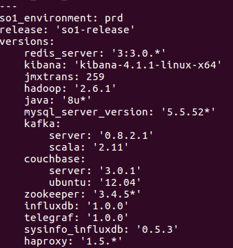
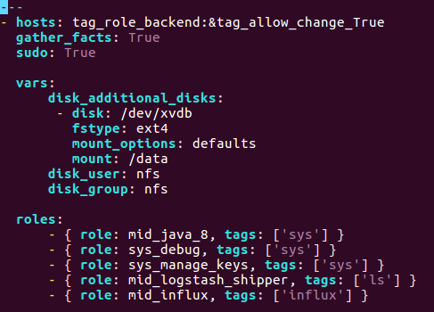
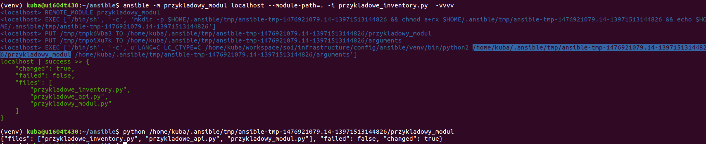
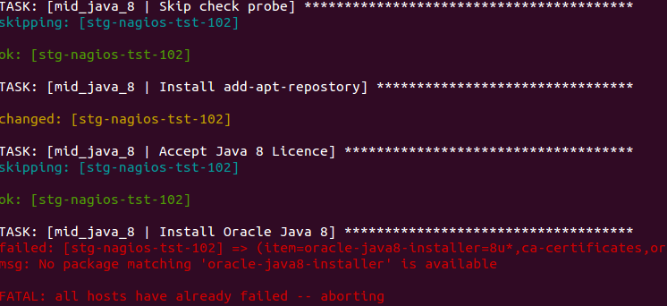

<!-- Wygenerowane z Dzien4_prezentacja.pptx przez szkolenie5dni/narzedzia/pptx_do_marp.py — nie edytuj ręcznie;
     zmieniaj pptx (albo build_dzienN_deck.py) i uruchom skrypt ponownie. -->

<!-- _class: tytul -->
# Ansible

Wszystko co musisz wiedzieć.

Jakub Muszyński

---

## Dzień 4 — plan

- 9:00 · Powtórka; wiele środowisk → L15, część A: dev na web04
- 10:00 · Gdzie trzymać zmienne; inventory dynamiczne i hybrydowe → L15, część B
- 11:00 · Sekrety: ansible-vault, przecieki, systemy zewnętrzne → L16
- 12:00 · Diagnostyka: komunikaty, -vvv, moduł od środka → L17
- 12:50 · obiad
- 13:25 · changed\_when, failed\_when, until, assert, block/rescue → L18, część A
- 14:25 · Restart bez przerwy: serial → L18, część B
- 15:25 · throttle a restart w handlerze z pętlą → L18, część C; podsumowanie

Laby: dzien4/lab · od dziś cztery hosty: web04 to środowisko dev

---

## Powtórka z dnia 3

- Co trafia do defaults/, a co do vars/ roli?
- Co oznaczają trzy części nazwy community.mysql.mysql\_db?
- Skąd aplikacja zna adres bazy, skoro nigdzie go nie wpisaliśmy?
- Co trzeba zmienić, żeby dołożyć serwer aplikacji?
- Dlaczego awarię jednego serwera aplikacji trudno zauważyć przez load balancer?

---

## Cel dnia: projekt gotowy do utrzymania

```
prod  web01  load balancer + baza       :8081
      web02  aplikacja
      web03  aplikacja

dev   web04  wszystko na jednym hoście  :8084
             (aplikacja na porcie 8080)
```

- Ten sam site.yml i te same role; różnice tylko w zmiennych
- Hasła w vault, osobne dla dev i prod
- Zmiany i restarty bez przerwy w działaniu

---

<!-- _class: maly -->
## Środowisko labu
<!-- Zamiennik slajdu „Środowisko labu” (schemat z kształtów w pptx) dla wersji Marp; pptx_do_marp.py wstawia
     ten plik zamiast tekstu wyciągniętego ze slajdu. Zmieniasz schemat w build_dzien1_deck.py — popraw i ten plik. -->

```
 Twój laptop              Twoja maszyna (Ubuntu 24.04 w AWS) - tylko Twoja
+--------------+  ssh    +-------------------------------------------------+
| terminal,    | ------> | Ansible (venv z L1) - control node              |
| edytor       | kursant@| laby: ~/dzien1 ... ~/dzien5                     |
+------+-------+ <adres> |                                                 |
       :                 | Docker - hosty labu pod adresem 127.0.0.1       |
       : zapasowe        | +---------+ +---------+ +---------+ +---------+ |
       : wejście, gdy    | | web01   | | web02   | | web03   | | web04   | |
       : bezpośrednie    | |ssh  2221| |ssh  2222| |ssh  2223| |ssh  2224| |
       : SSH nie działa  | |www  8081| |www  8082| |www  8083| |www  8084| |
       :                 | +---------+ +---------+ +---------+ +---------+ |
       :                 +------------------------+------------------------+
       v                                          | -i inventory/szkolenie/prod.yml
 Wspólne dla grupy - sieć szkolenia w AWS         v
+------------------+   +-------+ +-------+ +-------+ +-------+
| mgmt (bastion)   |   | web01 | | web02 | | web03 | | web04 |  zapasowe hosty
| ssh szkolenieNN@ |   |chmura | |chmura | |chmura | |chmura |  i pokaz rozwiązań;
+------------------+   +-------+ +-------+ +-------+ +-------+  wspólne - uzgadniamy
```

- dzień 1–2: web01, web02 · dzień 3: + web03 · dzień 4: + web04
- Prowadzący: `srodowisko.yml` (maszyny w AWS), `przygotuj_kursantow.yml` (Docker, hosty, laby)
- Albo Twój laptop z Dockerem: `lab-env/setup.sh` — te same hosty i porty

---

## Zarządzanie wieloma środowiskami?

- Wiele inventory
- Inventory dynamiczne
- warunkowe includowanie  
  when: env=prod w kodzie

Utrzymanie wersji aplikacji:

- system\_version\_files manifest ->
- key-value store



---

## Układ projektu z wieloma środowiskami

```
site.yml
ansible.cfg            inventory = inventories/dev
group_vars/            wspólne dla wszystkich środowisk
inventories/
  prod/
    hosts.yml
    group_vars/all/main.yml   srodowisko, odnośniki do haseł
    group_vars/all/vault.yml  hasła (zaszyfrowane)
  dev/   …tak samo, inne wartości
roles/   requirements.yml
```

**Domyślnie dev; prod tylko jawnie: -i inventories/prod**

---

## Lab L15 — część A

**25 minut · L15\_srodowiska.md, kroki 1–7**

- inventory → inventories/prod; domyślnie dev
- inventories/dev: web04 we wszystkich warstwach
- zmienne dev: port aplikacji 8080, inne hasła

**Gotowe, gdy: curl localhost:8084 pokazuje DEV, a prod --check daje changed=0**

---

## Gdzie trzymać zmienne

**Gdzie trzymać zmienne?**

Filozofia ansible vs życie

- Statycznie: problem dostępności zmiennych (role, group/host\_vars, etc.) → strasznie dużo ‘includowania’
- Możliwa alternatywa: lookup + consul/etcd/zookeeper/?
- Dynamiczne inventory i “vars-y”

Wiele strategii - rozważ, czego potrzebujesz.

---

## group\_vars obok playbooka a w inventory

```
-e
…
group_vars/ obok playbooka        ← wygrywa
inventories/dev/group_vars/
…
roles/*/defaults/
```

- Obok playbooka: to, czego środowiska nie zmieniają (spięcie z bazą, parametry roli MySQL)
- W inventories/<środowisko>/: wartości różne dla środowisk (nazwy, porty, hasła)
- Ta sama zmienna w obu miejscach = środowisko przegrywa (pułapka z L15, krok 9)

---

## Inventory dynamiczne

```
$ dynamiczne/kontenery.py --list
{"kontenery": {"hosts": ["web01", …]},
 "_meta": {"hostvars": {"web01": {"ansible_port": 2221}, …}}}
```

- Skrypt: dowolny program wykonywalny, --list zwraca JSON
- Wtyczka (zalecana): plik YAML z plugin: amazon.aws.aws\_ec2, azure.azcollection.azure\_rm, community.vmware…
- Źródło prawdy: chmura, CMDB, wirtualizacja — nie ręcznie utrzymywana lista

---

## Inventory hybrydowe

```
ansible-inventory -i dynamiczne/ --graph

dynamiczne/
  grupy.yml       # statyczne: produkcja, monitorowane
  kontenery.py    # dynamiczne: hosty i adresy
```

- Katalog jako inventory: Ansible czyta pliki alfabetycznie i łączy hosty o tych samych nazwach
- Kilka -i to też łączenie: -i inventories/dev -i inventories/prod = oba środowiska naraz
- Grupy z tagów chmury: keyed\_groups i constructed (przyklady/aws\_ec2.yml)

---

## Operacje na zbiorach

Można (np w obrębie Playbook), wykonać sumę logiczną na grupach:

W definicji playbook:

```
- hosts: group1:&group2
```

W tasku:

```
- name: jakis_task
  when: inventory_hostname in groups.frontendcluster1
```

[https://groups.google.com/forum/#!topic/ansible-project/lr7nXyGw0UY](https://groups.google.com/forum/#!topic/ansible-project/lr7nXyGw0UY)



---

## Lab L15 — część B

**35 minut · L15\_srodowiska.md, kroki 8–12**

- wspólne zmienne do group\_vars obok site.yml
- pułapka: kto wygrywa
- kontenery.py: chmod +x, --list, ping
- hybryda: grupa monitorowane; dwa -i naraz

---

## A jak zmienne, to sekrety!

ansible-vault

Zaszyfruj (AES) poufne zmienne transparentnie dla Ansible

```
ansible-vault encrypt foo.yml bar.yml baz.yml
```

zmienna systemowa ANSIBLE\_VAULT\_PASSWORD\_FILE

---

## A jak zmienne, to i sekrety!

ansible-vault

‘good practice’:

Zmienna ‘widoczna’ w **nie**zaszyfrowanym pliku powinna wskazywać na kolejną zmienną w ansible-vault:

rundeck\_token: "{{ rundeck\_token\_vault }}"

Zmienna w ansible-vault będzie ukryta = niemożliwa do wyszukania normalnymi sposobami:

rundeck\_token\_vault: "1234567890"

---

## Osobne hasło dla każdego środowiska

```
ansible-vault encrypt --vault-id dev@~/.vault_dev \
  inventories/dev/group_vars/all/vault.yml

$ANSIBLE_VAULT;1.2;AES256;dev

# ansible.cfg
vault_identity_list = dev@~/.vault_dev

ansible-playbook -i inventories/prod site.yml \
  --vault-id prod@prompt
```

- Hasło dev zna zespół; hasło prod — CI albo AWX

---

## Gdzie wyciekają sekrety

- --diff pokazuje treść zmienionego pliku z hasłem → diff: false na zadaniu
- Pętla wypisuje każdy element, także hasło → no\_log: true (w roli z Galaxy: mysql\_hide\_passwords)
- -v i -vvv pokazują argumenty i wyniki modułów
- Plik z hasłem na serwerze z mode 0644 czyta każdy użytkownik → 0640 i właściwa grupa

**Logi CI i AWX czyta więcej osób niż vault**

---

## Sekrety poza repozytorium

**ansible-vault**

- zaszyfrowane pliki w repozytorium
- jedno hasło na środowisko
- rotacja = edycja pliku i commit
- bez dodatkowej infrastruktury

**systemy zewnętrzne**

- HashiCorp Vault: community.hashi\_vault
- AWS Secrets Manager, SSM: amazon.aws
- CyberArk: cyberark.pas
- AWX: credentials wstrzykiwane do zadań

Lookup pobiera sekret w chwili uruchomienia: rotacja bez zmian w repozytorium, dostęp i audyt w jednym miejscu.

---

## Lab L16 — vault

**35 minut · L16\_vault.md**

- group\_vars/all/ jako katalog: main.yml + vault.yml
- hasła dev i prod, encrypt z --vault-id
- przeciek przez --diff i pętlę → diff: false, no\_log, 0640
- rotacja hasła jednym uruchomieniem

---

## Debugging

- zmienne
- moduł

sprawdzanie składni

---

## Jak czytać komunikat błędu

```
[ERROR]: Task failed: object of type 'dict' has no
         attribute 'default_ipv4_address'
Origin: debuguj.yml:34:7
<<< caused by >>>
Origin: templates/raport.txt.j2
```

- \[ERROR\] — co się stało; Origin — plik, linia, kolumna
- caused by — przyczyna głębiej (szablon, zmienna, warunek)
- YAML: „missing quotes around a template block” — wartość od {{ w cudzysłowie

---

## Narzędzia diagnostyki

```
ansible-playbook play.yml -v | -vvv
ansible web04 -m setup -a 'filter=ansible_default_ipv4'
ansible.builtin.debug: var=zmienna
ansible-playbook play.yml --start-at-task 'Nazwa'
ansible-playbook play.yml --step
debugger: on_failed           # interaktywnie
```

- Najpierw komunikat, potem dane (debug, setup), na końcu -vvv

---

## Debugging - na poziomie Pythona

Verbose level: **-vvvv**

Możliwość debugowania poprzez uruchomienie lokalnego skryptu  
export ANSIBLE\_KEEP\_REMOTE\_FILES=1



---

## Moduł od środka

```
ANSIBLE_KEEP_REMOTE_FILES=1 ANSIBLE_PIPELINING=0 \
  ansible web04 -m ping -vvv

# na web04
python3 AnsiballZ_ping.py explode   # → debug_dir/
vi debug_dir/ansible/modules/ping.py
python3 AnsiballZ_ping.py execute
```

- Moduł to program w Pythonie spakowany z argumentami i wysłany na host
- Przy pipelining moduł nie trafia na dysk — stąd ANSIBLE\_PIPELINING=0

---

## chicken-egg?

```
Nie zawsze działa --check 
np: (apt-add-repository + apt-get install)
```



---

## Lab L17 — diagnostyka

**35 minut · L17\_diagnostyka.md**

- debuguj.yml: pięć błędów, po jednym na uruchomienie
- czytaj Origin i caused by
- moduł ping rozpakowany i zmieniony na web04

---

## changed\_when i failed\_when

```
- name: Policz błędy w logu
  ansible.builtin.command: grep -c ERROR error.log
  register: bledy
  changed_when: false        # odczyt to nie zmiana
  failed_when: bledy.rc > 1  # rc=1: brak trafień
```

- ignore\_errors: true — błąd zostaje błędem, play idzie dalej (ignored w PLAY RECAP)
- failed\_when: false — zadanie nigdy nie jest błędem
- Najlepiej: precyzyjny warunek, który mówi, co jest błędem

---

## until i assert

```
- ansible.builtin.uri:
    url: http://localhost:8080/health
  register: zdrowie
  until: zdrowie.status == 200
  retries: 10
  delay: 2

- ansible.builtin.assert:
    that: "'połączona z' in strona.content"
    fail_msg: "brak połączenia z bazą"
```

---

## block, rescue, always

```
- block:
    - kopia zapasowa konfiguracji
    - zmiana
    - restart i sprawdzenie
  rescue:                 # gdy coś w block padnie
    - przywróć kopię, restart
    - ansible.builtin.fail: zgłoś wycofanie
  always:                 # zawsze
    - wpis w dzienniku zmian
```

- W rescue: ansible\_failed\_task i ansible\_failed\_result — co i dlaczego padło

---

## Lab L18 — część A

**35 minut · L18\_sterowanie.md, część A**

- sterowanie.yml: TODO 1–5
- -e zepsuj=true: zmiana wycofana, strona działa
- site.yml przywraca stan z kodu

---

## serial: zmiana po kawałku

```
- hosts: appservers
  serial: 1               # albo 2, albo "30%", albo [1, 5, "100%"]
  max_fail_percentage: 0
  tasks: …
```

- Cały play na pierwszej partii hostów, potem na następnej
- Błąd całej partii zatrzymuje play — reszta hostów nietknięta
- run\_once: zadanie raz na play (np. migracja bazy), nie raz na host

---

## Węzeł wrócił do puli?

```
- name: Czekaj, aż load balancer znów kieruje ruch na ten serwer
  ansible.builtin.uri:
    url: http://localhost/
    return_content: true
  delegate_to: "{{ groups['loadbalancers'][0] }}"
  register: przez_lb
  until: "('Serwer: ' ~ inventory_hostname) in przez_lb.content"
```

Sam węzeł może już działać, a load balancer jeszcze go omija. Następny restart dopiero po potwierdzeniu.

---

## Lab L18 — część B

**35 minut · L18\_sterowanie.md, część B**

- drugi terminal: pętla z curl — co widzi użytkownik
- restart bez serial: 502; z serial: 1 — same 200
- -e awaria\_na=web02: play stoi, web03 nietknięty

---

## serial, throttle, pętla z delegate\_to

**serial**

- cały play po partiach
- proste, ale spowalnia wszystkie zadania

**throttle**

- jedno zadanie na N hostach naraz
- w bloku: każde zadanie osobno — wieloetapowy restart nie jest „po jednym”

Restart po jednym węźle tylko w kroku restartu: handler z run\_once i pętla po węzłach (następny slajd).

---

## Restart klastra w handlerze

```
handlers:
  - name: Restart klastra po kolei
    ansible.builtin.include_tasks: restart_klastra_petla.yml
    run_once: true

# restart_klastra_petla.yml
- any_errors_fatal: true
  block:
    - ansible.builtin.include_tasks: restart_wezla.yml
      loop: "{{ groups['appservers'] }}"
      loop_control: {loop_var: wezel}
```

W restart\_wezla.yml każde zadanie z delegate\_to: "{{ wezel }}". Wzorzec z restartów Kafki.

---

## Lab L18 — część C

**15 minut · L18\_sterowanie.md, część C**

- restart\_throttle.yml: dlaczego są 502?
- restart\_klastra.yml: same 200; z awarią — przerwane przed web03

---

## Podsumowanie dnia 4

- Środowiska: inventories/<środowisko>, domyślnie dev; wspólne zmienne obok playbooka
- Inventory dynamiczne i hybrydowe: źródło prawdy poza plikiem
- Vault z osobnym hasłem na środowisko; przecieki przez --diff, pętle i uprawnienia
- Komunikat błędu: Origin i caused by; moduł można rozpakować i uruchomić ręcznie
- Zmiany z wycofaniem (block/rescue) i restart bez przerwy (serial, pętla z delegate\_to)

**Jutro: AWX, ansible-lint i Molecule, przyspieszanie, Windows**

---

## Zadanie domowe

- Środowisko test: co trzeba dodać? Zrób to na papierze (albo w repozytorium)
- L16, dodatkowe: git diff dla plików vault
- Pomyśl o restarcie, który robisz w pracy ręcznie: który wzorzec z L18 pasuje?
- Pytania z sekcji „Sprawdzenie” w L15–L18 — omówimy rano

---

## Pytania?


