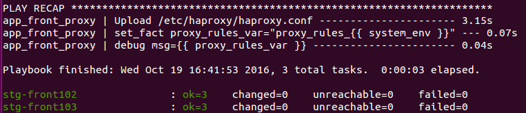
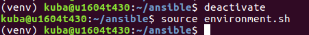

<!-- Wygenerowane z Dzien5_prezentacja.pptx przez szkolenie5dni/narzedzia/pptx_do_marp.py — nie edytuj ręcznie;
     zmieniaj pptx (albo build_dzienN_deck.py) i uruchom skrypt ponownie. -->

<!-- _class: tytul -->
# Ansible

Wszystko co musisz wiedzieć.

Jakub Muszyński

---

## Dzień 5 — plan

- 9:00 · Powtórka; AWX: po co i jak działa → L19, część A
- 10:00 · Szablony, ankiety, harmonogramy, uprawnienia → L19, część B
- 11:00 · AWX jako kod; execution environments; instalacja AWX → L19, część C
- 12:00 · Jakość: ansible-lint → L20, część A
- 12:50 · obiad
- 13:25 · Molecule i test w CI → L20, część B
- 14:25 · Lookupy, delegacja, async, przyspieszanie → L21
- 15:25 · Utrzymanie Ansible latami → L1, część B; Windows (pokaz); podsumowanie

---

## Powtórka z dnia 4

- Dlaczego domyślnym inventory jest dev?
- Gdzie wyciekają sekrety poza plikiem vault?
- Jak czytać komunikat błędu: co mówi Origin, a co caused by?
- rescue a ignore\_errors — różnica?
- serial, throttle, pętla z delegate\_to — kiedy które?

---

<!-- _class: tytul -->
# Interfejs Web

---

## AWX: po co

**Ansible z terminala**

- kod na laptopie albo serwerze
- hasła w plikach u osoby uruchamiającej
- kto, kiedy, z jakim wynikiem — w historii powłoki
- uruchamia ten, kto ma dostęp SSH

**AWX**

- kod zawsze z gita
- hasła w poświadczeniach — używane, niewidoczne
- każde zadanie zapisane: kto, co, wynik
- przycisk, harmonogram, API; uprawnienia per szablon

AWX — projekt otwartoźródłowy; Ansible Automation Platform — wersja Red Hat z pomocą techniczną.

---

## Twój projekt w AWX

```
repozytorium z site.yml i rolami  → Project
inventories/prod                   → Inventory (źródło: projekt)
klucz SSH, hasło vault prod        → Credentials
ansible-playbook -i … site.yml     → Job Template
-e aplikacja_wersja=1.1            → Survey
kto może wdrożyć prod              → RBAC (Execute)
```

- AWX uruchamia zadania w kontenerach: execution environments
- Wydania AWX wstrzymane od 24.6.1 (lipiec 2024), projekt w przebudowie; AAP rozwijane dalej

---

## Lab L19 — część A

**25 minut · L19\_awx.md, kroki 1–4**

- adres Twojej maszyny widziany z AWX
- poświadczenia: Machine i Vault (prod)
- projekt z gita, inventory z pliku inventories/awx/hosts.yml

---

## Szablon zadania

- Inventory + projekt + playbook + poświadczenia = przycisk Launch
- Job Type: Run albo Check (raport dryfu bez zmian)
- Survey: pytania przy uruchomieniu → zmienne -e; typ Password dla sekretów
- Schedules: uruchomienia o stałej porze; Notifications: e-mail, Slack, webhook
- Workflow: kilka szablonów po kolei, z gałęziami na sukces i błąd

---

## Uprawnienia (RBAC)

**Role na obiektach**

- Admin — zmienia i uruchamia
- Execute — tylko uruchamia
- Read — widzi wyniki
- Use (poświadczenia, inventory) — może użyć w szablonie

**Komu**

- użytkownikom i zespołom
- w organizacjach
- z logowaniem LDAP, SAML, OIDC
- hasło prod tylko w AWX — nikt go nie zna

---

## Lab L19 — część B

**35 minut · L19\_awx.md, kroki 5–9**

- szablon site.yml na prod: changed=0
- ankieta: wersja aplikacji 1.1 → curl localhost:8081
- harmonogram w trybie Check
- Execute dla sąsiada: uruchomi, nie zmieni

---

## AWX jako kod: awx.awx

```
module_defaults:
  group/awx.awx.controller:
    controller_host: "{{ awx_adres }}"
    controller_oauthtoken: "{{ awx_token }}"
tasks:
  - awx.awx.project: {name: …, scm_url: …}
  - awx.awx.inventory_source: {source_path: inventories/awx/hosts.yml}
  - awx.awx.job_template: {playbook: site.yml, survey_spec: …}
  - awx.awx.job_launch: {wait: true}
```

- Konfiguracja AWX w gicie: przegląd zmian, historia, odtworzenie od zera

---

## Execution environments

```
# execution-environment.yml
version: 3
dependencies:
  galaxy: requirements.yml
  python: [boto3]

ansible-builder build -t moj-ee:1.0
ansible-navigator run site.yml --eei moj-ee:1.0
```

- Obraz kontenera: ansible-core, kolekcje, biblioteki Pythona — ten sam w AWX i u Ciebie
- Instalacja AWX: operator na Kubernetes (np. k3s) — pokaz

---

## Lab L19 — część C

**30 minut · L19\_awx.md, kroki 10–12**

- awx.awx z requirements.yml; token z zakresem Write
- TODO: job\_template z ankietą i job\_launch

**Gotowe, gdy: zadanie z kodu ustawia wersję 1.2, drugie uruchomienie changed=0**

---

## ansible-lint

```
ansible-lint                       # cały projekt
ansible-lint --fix plik.yml        # poprawki automatyczne
ansible-lint -L                    # lista reguł

- name: Odczyt
  ansible.builtin.command: cat plik
  changed_when: false
  # noqa: reguła — świadomy wyjątek z uzasadnieniem
```

- Profile: min → basic → moderate → safety → shared → production
- Kod od asystenta AI przechodzi przez te same bramki

---

## Tematy otwarte

- Zawsze sprawdzaj czy działa --check
- Ustawiaj ‘changed: false’, jeśli trzeba (do raportowania zmian)
- README/Meta w każdej roli, zawierające przykład wykonania wraz ze zmiennymi
- tagowanie
- Zacznij od prostych rzeczy!
- (otwarte) common logging
- (otwarte) szybkie testy całego systemu
- (otwarte) kod błędu po zakończeniu ansible-playbook \[changed != 0\]
- Pre\_tasks

---

## Lab L20 — część A

**35 minut · L20\_jakosc.md, kroki 1–4**

- projekt: production bez uwag
- stary playbook: ok. 20 uwag → --fix → ręcznie

**Gotowe, gdy: stary playbook przechodzi profil production**

---

## Molecule: test roli w kontenerze

```
roles/aplikacja/molecule/default/
  molecule.yml    # kontener Ubuntu 24.04 z systemd
  converge.yml    # wdrożenie roli
  verify.yml      # sprawdzenie wyniku

molecule test
# destroy → create → converge → idempotence → verify → destroy
```

- idempotence: drugie uruchomienie roli musi dać changed=0
- verify: zachowanie (strona działa), nie tylko brak błędów

---

## Test w CI

- Każda zmiana w repozytorium: ansible-lint i molecule test
- Co tydzień: nowa wersja Ansible — wiesz o problemie, zanim trafi na produkcję
- Laby tego szkolenia: GitHub Actions przechodzi pięć dni krok po kroku, na Pythonie 3.12 i 3.13

Przykład do skopiowania: jakosc/ci.PRZYKLAD.yml.

---

## Lab L20 — część B

**35 minut · L20\_jakosc.md, kroki 5–9**

```
molecule converge, login, idempotence
```

- verify.yml: strona i uprawnienia config.cfg
```
molecule test; zepsuj rolę i zobacz, że test to wychwyci
```

---

## Lookup’s

Możliwe moduły:

- file
- url
- etcd
- inne

---

## Lookupy, delegacja, async

```
lookup('ansible.builtin.pipe', 'hostname')   # control node!
query('ansible.builtin.inventory_hostnames', 'appservers')

delegate_to: localhost
run_once: true

async: 60
poll: 0          # nie czekaj; wynik: async_status
```

- Lookup działa tam, gdzie Ansible — na Twojej maszynie albo w kontenerze AWX

---

## Callback -> profilowanie



---

## Przyspieszanie

**Ustawienia**

- profile\_tasks: gdzie ucieka czas
- forks: ile hostów naraz (domyślnie 5)
- pipelining: mniej operacji SSH
- gathering = smart + fact\_caching

**Dalej**

- mitogen: moduły w trwałym procesie Pythona
- strategy: free — hosty nie czekają na siebie
- mniej zadań: lista w apt zamiast loop
- async dla długich zadań

Najpierw zmierz (profile\_tasks), potem zmieniaj.

---

## Lab L21 — lookupy, async, przyspieszanie

**35 minut · L21\_przyspieszanie.md**

- ciekawostki.yml: lookup, query, delegate\_to, async
- pomiar: pipelining, forks, pamięć faktów, mitogen

**Zapisz czasy — porównamy na tablicy**

---

**Instalacja - vitualenv - “infrastructure as a code”?**

- Coś jak ‘chroot’ - tyle że dla “python’a”
- Niezależna od systemu
- Łatwa aktualizacja
- Możliwość współistnienia wielu wersji Ansible na raz!
- Customizacja

---

## Instalacja — source\_me.sh

```
#!/usr/bin/env bash
ANS_ROOT_DIR="$(cd "$(dirname "${BASH_SOURCE[0]}")" && pwd)"
export ANSIBLE_CONFIG="$ANS_ROOT_DIR/ansible.cfg"
# export ANSIBLE_VAULT_PASSWORD_FILE=~/.ansible/vault_pass.txt

if [ ! -d "$ANS_ROOT_DIR/venv" ]; then
  python3 -m venv "$ANS_ROOT_DIR/venv"
  __install=true
fi
source "$ANS_ROOT_DIR/venv/bin/activate"
[ "$__install" = true ] && \
  pip install -r "$ANS_ROOT_DIR/requirements.txt"
```

Pełna wersja: dzien1/lab/source\_me.sh (opcja -i: ponowna instalacja pakietów).

---

## Instalacja — requirements.txt

```
pip freeze | grep -iE '^ansible(-core)?==' > requirements.txt

ansible==14.6.0
ansible-core==2.21.6
```

```
ansible = ansible-core + zestaw kolekcji (ansible.posix, community.general…)
ansible-core 2.22 wymaga Pythona 3.13; na Ubuntu 24.04 (Python 3.12) pip da 2.21
```

- Przypięta wersja = to samo środowisko u każdego i w CI

---

**Instalacja - “infrastructure as a code”?**

ładowanie środowiska

$ **.** source\_me.sh

```
$ source source_me.sh
```



---

## ansible.cfg

```
[defaults]
inventory = inventory/hosts.yml
callbacks_enabled = ansible.posix.profile_tasks

[ssh_connection]
pipelining = True
```

- Ansible czyta ansible.cfg z bieżącego katalogu (albo z ANSIBLE\_CONFIG)
- Co zmieniliśmy: ansible-config dump --only-changed
- Katalog zapisywalny dla wszystkich (np. /mnt/c w WSL): ansible.cfg pominięty
- Wszystkie opcje z opisami: ansible-config init --disabled

---

## Utrzymanie latami

- Nowe ansible-core mniej więcej dwa razy w roku; stare składnie znikają (np. include:)
- Przed aktualizacją: porting guide i ostrzeżenia DEPRECATION w logach
- Aktualizacja: nowy venv obok starego → testy → przełączenie; stary zostaje na wszelki wypadek
- Test playbooków na nowej wersji automatycznie, np. co tydzień w CI — tak testujemy laby tego szkolenia

---

## Lab L1 — część B

**7 minut · ~/dzien1, L1\_srodowisko.md, część B**

- ansible.cfg: co zmieniliśmy względem domyślnych
- requirements.txt z przypiętą wersją
- source\_me.sh — jeśli zostanie czas

---

## Ansible i Windows

```
ansible_connection: winrm        # albo ssh (Windows Server 2019+)
ansible_shell_type: powershell   # przy ssh

- ansible.windows.win_feature: {name: Web-Server}
- ansible.windows.win_copy: {content: …, dest: C:\inetpub\wwwroot\index.html}
- ansible.windows.win_service: {name: W3SVC, state: started}
- ansible.windows.win_powershell: {script: Get-Service W3SVC}
```

- Na hoście bez Pythona: moduły w PowerShell; become to runas
- Kolekcje ansible.windows, community.windows, microsoft.ad

---

## Własny moduł (opcja)

```
library/naszaaplikacja_info.py
  DOCUMENTATION, EXAMPLES, RETURN   → ansible-doc -M library
  AnsibleModule(argument_spec=…, supports_check_mode=True)
  module.exit_json(changed=False, ansible_facts={…})
```

- Do udostępniania: kolekcja (plugins/modules)
- Ansible z Pythona: ansible-runner (tego używa AWX)

---

## Pięć dni w jednym slajdzie

- Dzień 1: inventory, ad-hoc, playbook, zmienne
- Dzień 2: moduły, szablony, warunki, pętle, wdrożenie aplikacji, handlery, tagi
- Dzień 3: role, Galaxy, trzy warstwy, skalowanie jedną linią
- Dzień 4: środowiska, vault, diagnostyka, zmiany bez przerwy w działaniu
- Dzień 5: AWX, jakość i testy, przyspieszanie

**Prawdą jest repozytorium, nie serwer**

---

## Co dalej

- Dokumentacja: docs.ansible.com; porting guide przed każdą aktualizacją ansible-core
- Twój projekt: requirements.txt i requirements.yml z wersjami, ansible-lint i Molecule w CI
- Zacznij od jednej powtarzalnej czynności, którą robisz ręcznie co tydzień
- Laby i rozwiązania zostają u Ciebie — wróć do nich, gdy będziesz potrzebować wzoru

**Ankieta — dziękujemy!**

---

## Pytania?


